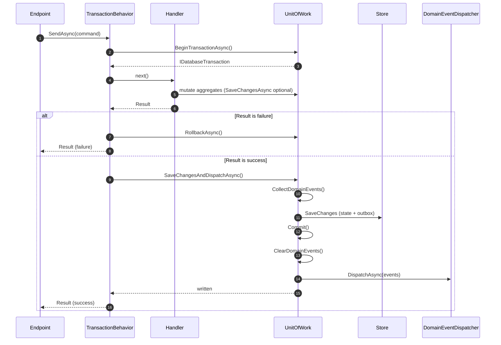

# Persistence and Dispatch Seam

Implementation reference for the transaction and domain-event dispatch seam defined by
[ADR-009](../decisions/ADR-009-Domain-Event-Dispatching-Strategy.md).

The seam is the single commit and dispatch point for commands. It is provided by the platform
(`BSX.BuildingBlocks`) and consumed by Infrastructure; modules never implement it themselves.

---

## Contracts

| Contract | Responsibility |
| --- | --- |
| `IUnitOfWork.SaveChangesAndDispatchAsync` | Persist state and events, commit, clear, dispatch. |
| `IUnitOfWork.SaveChangesAsync` | Persist pending tracked changes (enlists in the current transaction). |
| `IUnitOfWork.BeginTransactionAsync` | Open the command transaction. |
| `IDatabaseTransaction` | `CommitAsync` / `RollbackAsync` / `DisposeAsync`. |
| `UnitOfWorkBase` | Abstract base implementing the ordered post-commit flow. |
| `IDomainEventDispatcher` | In-process post-commit domain event dispatch. |
| `TransactionBehavior<TRequest, TResponse>` | Pipeline behavior that wraps commands and invokes the seam. |

---

## Ordering Guarantees

`UnitOfWorkBase.SaveChangesAndDispatchAsync` performs, in order:

1. **Collect** pending domain events from the tracked aggregates.
2. **Persist** state and outbox rows atomically (Infrastructure `SaveChangesAsync`).
3. **Commit** the transaction opened for the command.
4. **Clear** the aggregates' in-memory events.
5. **Dispatch** the collected events in-process.

Dispatch therefore always happens **after** commit, and events that are persisted but not yet
dispatched survive a crash for recovery (ADR-009).

Infrastructure implements the store-specific hooks: `SaveChangesAsync`, `BeginTransactionAsync`,
`CollectDomainEvents`, `ClearDomainEvents`, and `CommitAsync`.

---

## Command Flow

Queries do not enter `TransactionBehavior`; they never open a transaction and never dispatch.

---

## Failure Semantics

- A failed `Result` from the handler rolls back the transaction and skips dispatch.
- An unhandled exception propagates; the transaction is disposed (rolled back by Infrastructure).
- A dispatch failure happens **after** commit; the business state stands and the failure is
  isolated and observable (ADR-009 §5). It is not rolled back.

---

## Registration

`AddBuildingBlocks` registers the canonical behaviors in order (Logging, Validation, Transaction).
Infrastructure must register an `IUnitOfWork` implementation; commands resolve it through
`TransactionBehavior`. See
[building-blocks.md](building-blocks.md) and
[implementation-guidelines.md](implementation-guidelines.md).

## Module composition

A host can load several modules, each owning its own DbContext. To avoid `IUnitOfWork`
registration conflicts and persistence failures:

- Every module unit of work implements `IModuleUnitOfWork` and is registered with
  `TryAddEnumerable(ServiceDescriptor.Scoped<IModuleUnitOfWork, ...>())`.
- Modules must **not** register `IUnitOfWork` directly.
- The host calls `AddCompositeUnitOfWork()` after the module infrastructure registrations.
- `CompositeUnitOfWork` resolves `IEnumerable<IModuleUnitOfWork>` and implements the ADR-009 seam
  across them: collect pending events from all modules, save all module contexts, commit all module
  transactions, clear the aggregates, then dispatch each event exactly once.
- If no module unit is registered, the composite throws at resolution (fail-fast).
- Cross-module atomicity across separate connections is **not** guaranteed. A command targets a
  single module aggregate; cross-module workflows use integration events / the outbox / a saga.

---

## Outbox implementation (v0.4.0)

`BSX.Persistence` provides the EF Core outbox used by every module. Each module `DbContext`
implements `IOutboxDbContext` and owns an `outbox_messages` table in its schema.

| Component | Responsibility |
| --- | --- |
| `OutboxSaveChangesInterceptor` | Collects `IHasDomainEvents` entries and adds outbox rows in the same `SaveChanges`; deduplicates by `EventId`. |
| `IOutboxStore` / `EfOutboxStore<TContext>` | Atomic claim (`Pending` → `Processing`), read, mark processed, record failure with exponential backoff, dead-letter, count backlog, requeue stale claims. |
| `DomainEventDispatcher` | Claims the persisted rows before dispatch, isolates each handler, marks processed/failed. Without stores (unit tests) it dispatches directly. |
| `OutboxRecoveryService` | Hosted loop that requeues stale claims, reads pending rows, reconstructs domain events, dispatches them, and publishes integration rows when a broker is enabled. |

Exactly-once semantics per attempt:

- The claim is a conditional atomic `UPDATE`; only one worker can transition a row out of
  `Pending`/eligible `Failed`.
- The dispatcher only dispatches claimed rows when stores are registered, so a concurrent request
  and recovery loop cannot both dispatch the same event.
- Retries re-run all handlers, so handlers must be idempotent (at-least-once with an idempotency key
  derived from `EventId`).

Crash recovery:

1. State and outbox rows commit atomically in the command transaction.
2. If the process dies after commit, the rows remain `Pending`.
3. `OutboxRecoveryService` claims and dispatches them on the next poll.
4. Claims left in `Processing` after `Outbox:StaleProcessingAfter` are requeued.

Integration rows remain pending unless `Outbox:IntegrationPublishingEnabled` is true. Replace the
default `IEventBus` with a broker-backed publisher before enabling it.

Configuration lives under `Outbox` (see [observability.md](../operations/observability.md)).
