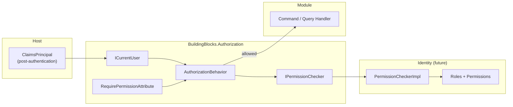
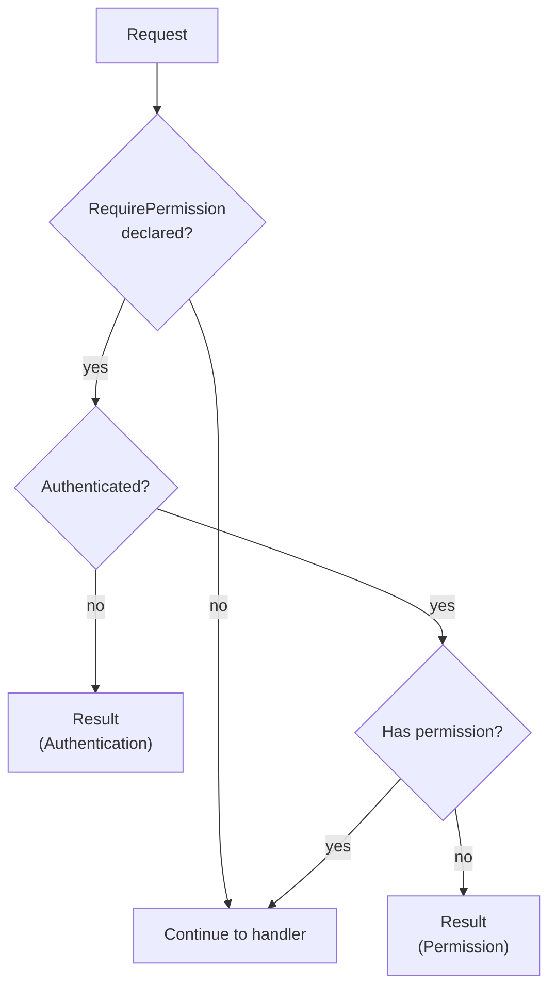
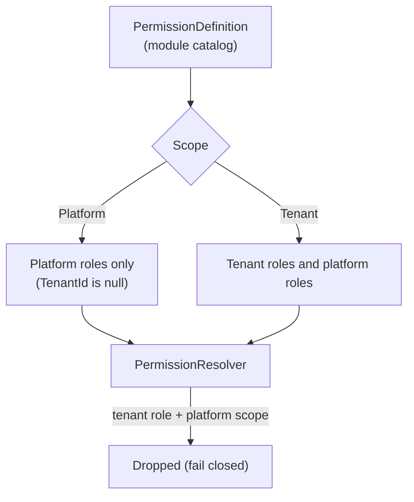
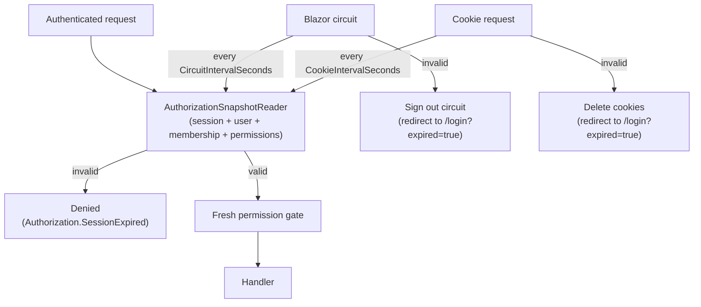
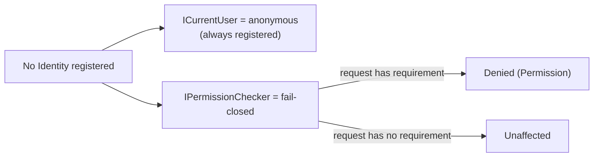

# Authorization

Permission-based authorization evaluated in the pipeline (ADR-012).

## Components

## Pipeline Decision

## Permission Scope (ADR-020)

- A tenant role can never grant a platform-scoped permission.
- Unknown permission codes contribute nothing.
- The web UI hides disallowed permissions, but the backend and the resolver remain authoritative.

## Authorization Revalidation (ADR-021)

- The snapshot is authoritative; cached token claims are never trusted for the gate.
- A missing, revoked, expired, deactivated or tenant-mismatched principal is denied.
- A store failure is treated as denied.

## Defaults Before Identity

- The gate is the permission (`resource.action`), not the role.
- Resource-level rules (ownership, tenant, entity state) are evaluated by the handler using
  `ICurrentUser`.
- Authentication (issuance/validation) is owned by Identity; the reserved permission claim type
  is `permission`.
