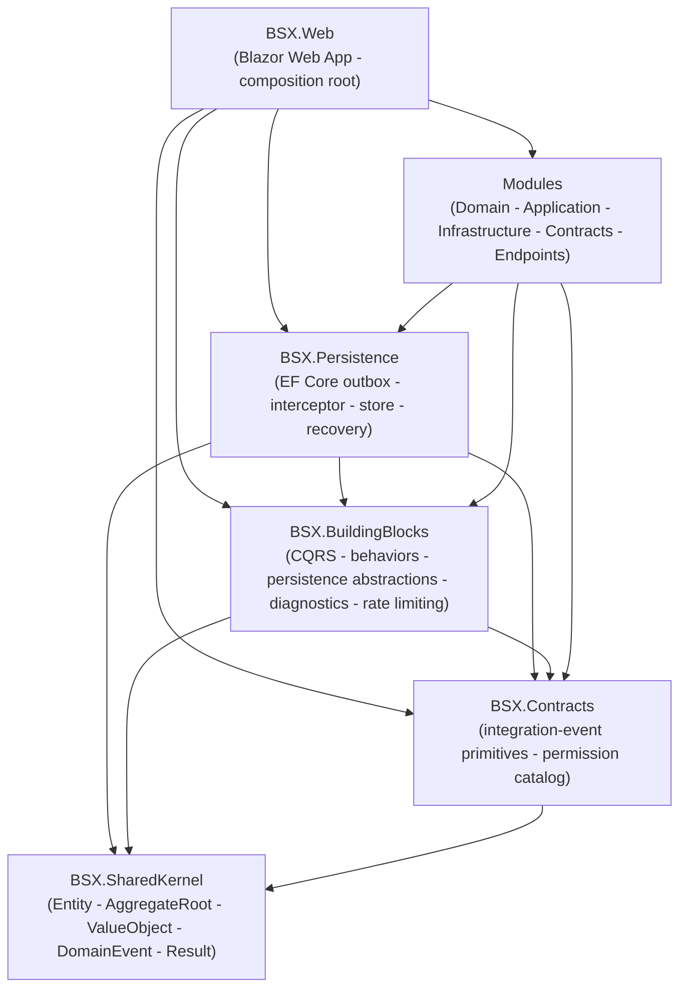

# Foundation Projects

Project dependency graph of the technical foundation.

Rules enforced by architecture tests:

- `BSX.SharedKernel` depends on nothing external.
- `BSX.Contracts` owns cross-module contract primitives and the permission catalog.
- `BSX.BuildingBlocks` depends on `BSX.SharedKernel` and `BSX.Contracts`; it never references EF Core.
- `BSX.Persistence` depends on the platform projects and EF Core; it never references a module.
- Modules depend on the kernel, contracts, building blocks and persistence; a module never
  references another module's implementation (only its Contracts).
