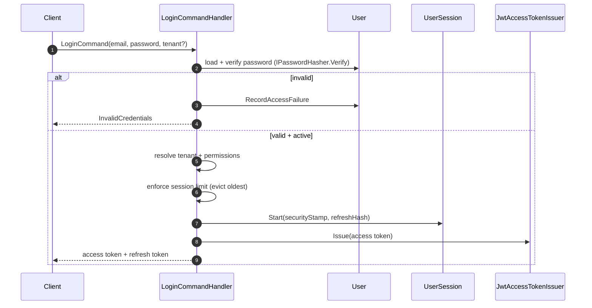

# Identity - Authentication and Authorization

Authentication, JWT issuance/validation, sessions and tenant-aware authorization for Identity
([ADR-012](../../decisions/ADR-012-Authorization-Architecture.md),
[ADR-013](../../decisions/ADR-013-Multi-Tenant-Identity-Strategy.md),
[ADR-017](../../decisions/ADR-017-Token-Invalidation-And-Session-Strategy.md)).

---

## Login

## Refresh, Rotation and Reuse Detection

- Refresh tokens are opaque; only the **hash** is stored.
- Each refresh **rotates** the token, linking the chain.
- A token presented after use within the **30-second grace window** rotates again (tolerates
  legitimate concurrent requests). Beyond the grace window it is treated as **theft**: the entire
  session is revoked and `RefreshTokenReuseDetected` is raised.
- The **security stamp is validated at refresh** (not per request): a changed stamp revokes the
  session and forces re-authentication.

## JWT

- **RS256**, asymmetric; keys carry a `kid`; public keys are exposed for a future JWKS endpoint.
- **Short-lived** access tokens (default 15 minutes); access tokens remain stateless.

| Claim | Meaning |
| --- | --- |
| `sub` | User identifier. |
| `tenant_id` | Active tenant (optional). |
| `principal_id` | Principal identifier (user or service account). |
| `principal_type` | `User` / `ServiceAccount`. |
| `permissions` | Effective permissions (one claim per permission). |
| `security_stamp` | Security stamp (validated at refresh). |
| `session_id` | Session identifier. |

`JwtAccessTokenValidator` validates issuer, audience, lifetime, algorithm (RS256) and signature.

## Authorization

- `[RequirePermission("module.resource.action")]` decorates a request; `AuthorizationBehavior`
  enforces it in the pipeline (after validation, before transaction).
- `IPermissionChecker` is **fail-closed**: not authenticated or missing permission → deny.
- Failures return a `Result` with `ErrorKind.Forbidden` (`Authorization.Forbidden`), never throw.
- Tenant-aware: permissions are resolved per tenant and embedded in the token.

### Permission resolution

`PermissionResolver` computes the union of the user's **platform (system) role** permissions and
the **active tenant membership** role permissions.

## Sessions

- `UserSession` owns a linear refresh-token chain with rotation, reuse detection and a grace window
  (ADR-017).
- Policy: 7-day token, 7-day idle timeout, 30-day absolute lifetime, 30-second grace window.
- **Session limit**: 10 active sessions per user; the oldest is evicted.
- Commands/queries: `LogoutCommand`, `LogoutAllCommand`, `RevokeSessionCommand`,
  `ListMySessionsQuery`.

## Infrastructure review fixes (implemented)

1. `IPasswordHasher.Verify` — constant-time PBKDF2 verification with backward-compatible parsing.
2. Optimistic concurrency — a shadow `Version` concurrency token on User/Role/TenantMembership/
   ServiceAccount/UserSession, incremented by the auditing interceptor.
3. Soft-delete uniqueness — partial unique index on `users.email` (`WHERE IsDeleted = false`).
4. System-role uniqueness — filtered unique index on `roles.name` (`WHERE TenantId IS NULL`).
5. Session persistence — `user_sessions` + `session_refresh_tokens` tables with rotation chain.

## Tenant Isolation

- `ITenantContext` resolves the active tenant from `ICurrentUser` (the JWT `tenant_id` claim).
- `TenantGuard` is **fail-closed**: an operation may only target the principal's active tenant. A
  missing/empty target returns `Identity.Authentication.InvalidTenant`; a mismatched tenant
  returns `Authorization.TenantForbidden`.
- Applied to tenant-scoped commands (invite user, create service account, set role permissions,
  assign role to membership). System roles are exempt from the tenant check (platform-level).

## Authentication Rate Limiting

- `IRateLimiter` is **fail-closed** and parameterized by a `RateLimitPolicy` (max requests + window).
- `InMemoryRateLimiter` (fixed window) is registered by default; replace it with a distributed
  limiter (for example Redis) when the API scales out.
- **Login** is limited per normalized email; **refresh** per token hash. Exceeding the limit returns
  `Identity.Authentication.TooManyRequests` as a `Result` (never an exception).
- Thresholds are configurable via `RateLimitOptions` (`Identity:RateLimiting`).

## Password Reset

Follows [ADR-016](../../decisions/ADR-016-Password-Reset-Security-Strategy.md).

- `RequestPasswordResetCommand` (anonymous): generates a 256-bit token, stores **only its hash** on
  the user (replacing any previous token), then delivers the plaintext token through the
  `IPasswordResetNotifier` **out-of-band port** (never persisted, never logged, never in the
  Outbox). Responses are **enumeration-safe** — always success, regardless of account existence.
- `CompletePasswordResetCommand` (anonymous): hashes the presented token, finds the user by hash,
  and completes the reset. The token is **single-use** and expires after **30 minutes**. A
  successful reset **revokes all sessions** (ADR-017).
- Ports: `IPasswordResetTokenHasher` (SHA-256), `IPasswordResetNotifier` (no-op default until the
  Notifications module registers a real implementation).
- Rate limited per email via `RateLimitOptions.PasswordReset`.

## Not implemented

API endpoints, Blazor UI and MFA remain out of scope. MFA hooks into login before token issuance.

## References

- [ADR-012 Authorization](../../decisions/ADR-012-Authorization-Architecture.md)
- [ADR-013 Multi-Tenant Identity](../../decisions/ADR-013-Multi-Tenant-Identity-Strategy.md)
- [ADR-017 Token Invalidation and Sessions](../../decisions/ADR-017-Token-Invalidation-And-Session-Strategy.md)
- [infrastructure.md](infrastructure.md)
