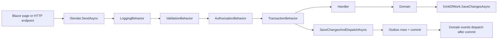
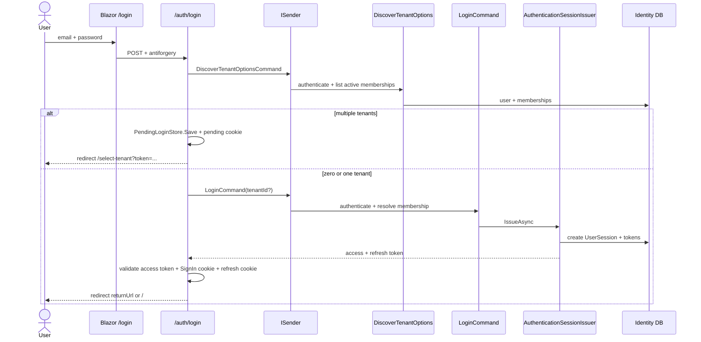

# BSX Platform — Onboarding / Onboarding

> Documento único bilingüe. La primera mitad está en español y la segunda en inglés.
> Single bilingual document. The first half is in Spanish; the second half is in English.
>
> Enfoque **code-first**: este documento describe el comportamiento real del código actual, no
> únicamente lo que dice la documentación existente. Las diferencias relevantes entre documentación
> y código se recogen en la sección de hallazgos para refactor.
>
> Code-first: this document describes the current code behavior, not only what the existing docs
> claim. Relevant documentation/code differences are listed in the refactor findings section.
>
> Baseline: `VersionPrefix` 0.4.0, code reviewed on 2026-11-04.
> Base: `VersionPrefix` 0.4.0, código revisado el 2026-11-04.

---

## Índice / Table of Contents

**Español**

1. [Cómo usar este documento](#español-1-cómo-usar-este-documento)
2. [Estado actual real](#español-2-estado-actual-real)
3. [Stack y mapa de la solución](#español-3-stack-y-mapa-de-la-solución)
4. [Cómo levantar la aplicación](#español-4-cómo-levantar-la-aplicación)
5. [Composición de arranque y ciclo de una petición](#español-5-composición-de-arranque-y-ciclo-de-una-petición)
6. [Flujos transversales](#español-6-flujos-transversales)
7. [Flujos de Identity](#español-7-flujos-de-identity)
8. [Flujos de CRM](#español-8-flujos-de-crm)
9. [Flujos de Sales](#español-9-flujos-de-sales)
10. [Flujos de la Web/UI](#español-10-flujos-de-la-webui)
11. [Superficie HTTP y autenticación](#español-11-superficie-http-y-autenticación)
12. [Configuración real](#español-12-configuración-real)
13. [Testing y depuración](#español-13-testing-y-depuración)
14. [Documentación frente a código y hallazgos para refactor](#español-14-documentación-frente-a-código-y-hallazgos-para-refactor)
15. [Chuleta de depuración](#español-15-chuleta-de-depuración)
16. [Glosario](#español-16-glosario)

**English**

1. [How to use this document](#english-1-how-to-use-this-document)
2. [Current state](#english-2-current-state)
3. [Stack and solution map](#english-3-stack-and-solution-map)
4. [How to run the application](#english-4-how-to-run-the-application)
5. [Startup composition and request lifecycle](#english-5-startup-composition-and-request-lifecycle)
6. [Cross-cutting flows](#english-6-cross-cutting-flows)
7. [Identity flows](#english-7-identity-flows)
8. [CRM flows](#english-8-crm-flows)
9. [Sales flows](#english-9-sales-flows)
10. [Web/UI flows](#english-10-webui-flows)
11. [HTTP surface and authentication](#english-11-http-surface-and-authentication)
12. [Actual configuration](#english-12-actual-configuration)
13. [Testing and debugging](#english-13-testing-and-debugging)
14. [Documentation vs code and refactor findings](#english-14-documentation-vs-code-and-refactor-findings)
15. [Debugging cheat sheet](#english-15-debugging-cheat-sheet)
16. [Glossary](#english-16-glossary)

---

# Español

## Español 1. Cómo usar este documento

Este documento está pensado para que una persona nueva pueda:

1. Levantar la aplicación en local sin adivinar configuración.
2. Entender cómo se compone el host y cómo viaja una petición.
3. Seguir cada flujo funcional desde la UI o la API hasta la base de datos.
4. Depurar por breakpoints, logs, tablas y tests.
5. Identificar deuda técnica y discrepancias antes de refactorizar.

Convenciones:

- Las rutas son relativas a la raíz del repositorio.
- Los comandos de ejemplo usan PowerShell 7 (`pwsh`), que es el shell del entorno.
- Los nombres de clases y archivos coinciden con el código actual.
- Cuando una capacidad existe en Domain/Application pero no está expuesta por API/UI, se indica
  explícitamente.
- Las referencias a documentación existente son secundarias. El código manda.

---

## Español 2. Estado actual real

### 2.1 Módulos

| Módulo | Domain | Application | Infrastructure | Endpoints/API | UI | Estado real |
| --- | --- | --- | --- | --- | --- | --- |
| Identity | Sí | Sí | Sí | Sí | Sí | Autenticación, sesiones, roles, permisos, memberships, password reset y administración. |
| CRM | Sí | Sí | Sí | Sí | Sí | Clientes, organizaciones, contactos y direcciones. |
| Sales | Sí | Sí | Sí | Sí | Sí | Leads y oportunidades. Sin quotations/orders/invoices. |
| Inventory | Sí | Sí | No | No | No | Solo dominio y aplicación. No está compuesto en `BSX.Web`. |
| Purchasing | No | No | No | No | No | No implementado. |
| Accounting | No | No | No | No | No | No implementado. |

### 2.2 Qué es la aplicación hoy

- Un **monolito modular** ASP.NET Core `.NET 10`.
- **Blazor Web App** con renderizado interactivo en servidor (`InteractiveServer`).
- **EF Core + PostgreSQL** con un schema por módulo (`identity`, `crm`, `sales`) y un historial de
  migraciones por schema.
- **CQRS in-process** con un `ISender` propio, no MediatR.
- **Outbox transaccional** por módulo para domain events.
- **API HTTP** para Identity, CRM y Sales.
- **UI Blazor** que llama directamente a comandos/queries in-process; la UI no consume la API HTTP.
- Un único host: `src/BSX.Web`.

### 2.3 Dos superficies de autenticación

| Superficie | Rutas | Esquema |
| --- | --- | --- |
| API | `/identity`, `/crm`, `/sales` | JWT Bearer |
| Health | `/health`, `/health/live`, `/health/ready` | Anónimo; el smart scheme lo enruta a JWT solo si se autentica |
| Web | `/`, `/app/...`, `/login`, `/select-tenant`, `/auth/...` | Cookie `BSX.Web.Cookie` |

`WebAuthenticationExtensions.SelectAuthenticationScheme` decide por prefijo de ruta (incluye
`/health` en la rama JWT, aunque los health checks están mapeados sin autorización). La cookie es
`HttpOnly`; el refresh token va en otra cookie `HttpOnly`; el navegador nunca recibe el access token
como dato manipulable por JavaScript.

### 2.4 Advertencias importantes antes de tocar código

- La documentación contiene afirmaciones desactualizadas. Ver sección 14.
- `Program.cs` compone los módulos manualmente; no existe el contrato `IModule` que mencionan
  algunos documentos.
- No todos los comandos tienen endpoint HTTP ni pantalla. Varias capacidades de Identity solo
  existen en Application o se usan solo desde Blazor.
- Los domain events se despachan **después del commit**. Un fallo en un handler no revierte el
  comando; queda registrado en el outbox para reintento.
- El rate limiting es **por proceso** (in-memory). No es exacto en múltiples instancias.
- La selección de workspace multi-tenant y la cola de emails de reset son **in-memory**.

---

## Español 3. Stack y mapa de la solución

### 3.1 Stack

| Capa | Tecnología |
| --- | --- |
| Runtime | .NET 10 |
| Web/UI | ASP.NET Core, Blazor Web App Interactive Server |
| Estilos | CSS propio en `src/BSX.Web/wwwroot/app.css`; no hay MudBlazor ni Tailwind referenciados |
| Persistencia | EF Core 10, Npgsql, PostgreSQL |
| Validación | FluentValidation |
| Logs | Serilog console |
| Observabilidad | OpenTelemetry (traces/metrics), OTLP opcional |
| Tests | xUnit, FluentAssertions, SQLite in-memory, Testcontainers PostgreSQL |
| Build | Central Package Management, warnings as errors, arquitectura testeada |

### 3.2 Proyectos principales

```text
src/
  BSX.SharedKernel/        DDD primitives + Result/Error
  BSX.Contracts/           Permission catalog contracts + integration primitives
  BSX.BuildingBlocks/      CQRS, behaviors, authorization, events, UoW, rate limiting, diagnostics
  BSX.Persistence/         Outbox EF Core implementation and background recovery
  BSX.Web/                 Composition root, Blazor UI, web auth adapters, demo seeders
  Modules/
    Identity/
      Domain/
      Application/
      Infrastructure/
      Endpoints/
    Crm/
      Domain/
      Application/
      Contracts/
      Infrastructure/
      Endpoints/
    Sales/
      Domain/
      Application/
      Contracts/
      Infrastructure/
      Endpoints/
    Inventory/
      Domain/
      Application/        (not composed in the host)
tests/
  BSX.ArchitectureTests/
  BSX.BuildingBlocks.UnitTests/
  BSX.SharedKernel.UnitTests/
  Composition/
  Integration/BSX.Web.IntegrationTests/
  Modules/{Identity,Crm,Sales,Inventory}/...
```

### 3.3 Dirección de dependencias

Reglas verificadas por `tests/BSX.ArchitectureTests`:

- `BSX.SharedKernel` no depende de nada externo.
- `BSX.BuildingBlocks` no depende de EF Core/Npgsql.
- `BSX.Persistence` no depende de ningún módulo.
- Domain no depende de BuildingBlocks, Persistence, EF Core, FluentValidation ni de otros módulos.
- Application no depende de Infrastructure/Endpoints ni de implementaciones de otros módulos; sí
  puede depender de `<OtroModulo>.Contracts`.
- Contracts solo depende de `BSX.Contracts`.
- Infrastructure solo puede ver otro módulo a través de sus Contracts.
- Endpoints no depende del Domain de su propio módulo.
- Todo `[RequirePermission]` debe existir en algún catálogo de permisos.

### 3.4 Estructura interna de un módulo

Flujo típico:

```text
Endpoints/UI
  -> Application (command/query + handler + validator)
    -> Domain (agregados, value objects, reglas)
      -> Infrastructure (repositorios, DbContext, interceptores)
        -> PostgreSQL (schema del módulo)
```

La UI Blazor no pasa por `Endpoints`: llama a `ISender` directamente en el circuito. Los endpoints
HTTP son adaptadores finos sobre los mismos comandos/queries.

---

## Español 4. Cómo levantar la aplicación

### 4.1 Requisitos

- .NET SDK `10.0.100` o superior dentro de la feature band permitida por `global.json`.
- Docker Desktop o un PostgreSQL accesible.
- `dotnet-ef` restaurado desde `.config/dotnet-tools.json`.

Verificación:

```powershell
dotnet --version
dotnet tool restore
```

### 4.2 PostgreSQL local

```powershell
docker run --name bsx-postgres `
  -e POSTGRES_PASSWORD=postgres `
  -p 5432:5432 `
  -d postgres:16
```

Si el contenedor ya existe:

```powershell
docker start bsx-postgres
```

### 4.3 Conexiones

En Development, si falta `ConnectionStrings:Identity`, `Program.cs` usa:

```text
Host=localhost;Port=5432;Database=bsx_identity;Username=postgres;Password=postgres
```

CRM y Sales usan su propia connection string si existe; si no, caen en la de Identity:

```powershell
$connection = "Host=localhost;Port=5432;Database=bsx_identity;Username=postgres;Password=postgres"

$env:ASPNETCORE_ENVIRONMENT = "Development"
$env:ConnectionStrings__Identity = $connection
$env:ConnectionStrings__Crm = $connection
$env:ConnectionStrings__Sales = $connection
```

Se puede usar una base distinta por módulo. Los schemas siguen siendo `identity`, `crm` y `sales`.

### 4.4 Migraciones

Cada módulo tiene su propio `IDesignTimeDbContextFactory` y su propio historial de migraciones.

```powershell
dotnet tool restore

dotnet ef database update `
  --project src/Modules/Identity/BSX.Modules.Identity.Infrastructure `
  -- --connection $connection

dotnet ef database update `
  --project src/Modules/Crm/BSX.Modules.Crm.Infrastructure `
  -- --connection $connection

dotnet ef database update `
  --project src/Modules/Sales/BSX.Modules.Sales.Infrastructure `
  -- --connection $connection
```

Notas:

- Identity puede aplicar migraciones al arrancar con
  `Identity:Database:ApplyMigrationsOnStartup=true`, pero solo es seguro en instancia única.
- CRM y Sales **no** tienen hook de migración al arrancar.
- `VerifySchema=true` añade health checks que fallan si hay migraciones pendientes.

### 4.5 Modo demo

```powershell
$env:Identity__Permissions__SynchronizeOnStartup = "true"
$env:Demo__SeedIdentity = "true"
$env:Demo__SeedSampleData = "true"

dotnet run --project src/BSX.Web --launch-profile http
```

Abrir `http://localhost:5272`.

Credenciales:

| Cuenta | Email | Password |
| --- | --- | --- |
| Administrador demo | `admin@bsx.local` | `Passw0rd!` |
| Invitado demo | `alex.rivera@bsx.local` | `Passw0rd!` |
| Invitado demo | `priya.shah@bsx.local` | `Passw0rd!` |

El seeder demo:

- Solo corre en `Development`.
- Es idempotente.
- Requiere que el schema Identity exista y que el rol de sistema `Administrator` exista.
- Usa los comandos de aplicación para crear datos, por lo que respeta reglas y permisos.
- Crea tenant demo `11111111-1111-1111-1111-111111111111`, 3 customers, 4 leads, 2 opportunities y
  2 usuarios listos para invitar.

### 4.6 Arranque sin demo

```powershell
$env:ASPNETCORE_ENVIRONMENT = "Development"
dotnet run --project src/BSX.Web --launch-profile http
```

En Development:

- Se genera una clave JWT RSA efímera si `Identity:Jwt:SigningKeys` está vacío.
- Data Protection usa `src/BSX.Web/.data-protection-keys` si no se configura otra ruta.
- `ReverseProxy:RedirectHttpToHttps` es `true` por defecto; con el perfil `http` normalmente no hay
  puerto HTTPS y la redirección no aplica. Para desarrollo estable se recomienda el perfil `https`.
- Si no hay base de datos, el host puede arrancar, pero login/API fallarán y la sincronización de
  permisos se saltará con warning si detecta un `DbException`.

### 4.7 Perfiles de launch

`src/BSX.Web/Properties/launchSettings.json`:

| Perfil | URLs |
| --- | --- |
| `http` | `http://localhost:5272` |
| `https` | `https://localhost:7278;http://localhost:5272` |

### 4.8 Orden real de arranque

1. Se construye el host y se configura Serilog.
2. Se registran BuildingBlocks.
3. Se registran Razor Components interactivos y health checks.
4. Se registra Identity: Application, Lockout, Infrastructure, JWT, deployment hardening,
   autenticación web, password reset delivery y health checks.
5. Se registra CRM (connection string propia o fallback).
6. Se registra Sales (connection string propia o fallback).
7. Se registra el `CompositeUnitOfWork`.
8. Se registra el outbox y su `OutboxRecoveryService`.
9. Se registra OpenTelemetry.
10. `app.UseWebDeploymentHardening()` valida configuración e instala forwarded headers/security
    headers.
11. Se aplican migraciones de Identity si están habilitadas.
12. Se sincronizan permisos de sistema si están habilitados.
13. Se ejecuta el seeder de identidad demo si está habilitado.
14. Se ejecuta el seeder de datos demo si está habilitado.
15. Se instala el pipeline HTTP.
16. Se mapean health checks, endpoints de módulos, endpoints web de auth y Razor Components.
17. `app.Run()`.

### 4.9 Problemas típicos de arranque

| Síntoma | Causa probable | Dónde mirar |
| --- | --- | --- |
| Falla al arrancar fuera de Development | Falta `ConnectionStrings:Identity`, `AllowedHosts`, `DataProtection:KeysPath` o claves JWT | Excepciones de `Program.cs`, `WebDeploymentHardeningExtensions`, `JwtOptionsConfiguration` |
| Login responde 401/500 | Schema Identity no migrado o base inaccesible | `/health/ready`, logs, `identity.__ef_migrations_history` |
| CRM/Sales devuelven error de relación | Schema CRM/Sales no migrado | Migraciones y `/health/ready` |
| Demo no crea datos | `Demo:SeedIdentity` o `Demo:SeedSampleData` en false, o no existe el rol Administrator | Logs de `DemoIdentitySeeder` / `DemoSampleDataSeeder` |
| No puedo iniciar sesión tras reiniciar | JWT efímero de Development cambió y/o cookie antigua | Volver a `/login`; en producción configurar claves estables |
| `AllowedHosts` inválido en producción | Wildcard o valor loopback por defecto | `ValidateAllowedHosts` |

---

## Español 5. Composición de arranque y ciclo de una petición

### 5.1 `Program.cs` en detalle

`src/BSX.Web/Program.cs` es el composition root. Puntos clave:

- `builder.Services.AddBuildingBlocks()` registra `ISender`, dispatcher de eventos, behaviors,
  `ICurrentUser` por defecto, tenant context, permission checker, rate limit store, post-command
  queue y `TimeProvider.System`.
- Cada módulo llama a `AddBuildingBlocks(assembly)` para escanear handlers, event handlers y
  validadores de su assembly.
- `AddIdentityApplication`, `AddIdentityInfrastructure`, `AddCrmApplication`,
  `AddCrmInfrastructure`, `AddSalesApplication`, `AddSalesInfrastructure` registran cada capa.
- `AddCompositeUnitOfWork` registra el único `IUnitOfWork` que usa el pipeline.
- `AddPlatformOutbox` registra el interceptor y el hosted service de recuperación.
- `AddWebAuthentication` registra cookie, policy scheme inteligente, antiforgery, revalidación y
  policies por permiso.
- `AddIdentityAuthentication` registra JWT Bearer para la API.

### 5.2 Pipeline HTTP real

```text
UseWebDeploymentHardening
  -> ForwardedHeaders (si ReverseProxy:Enabled)
  -> Security headers
  -> Serilog request logging
  -> ExceptionHandler + HSTS (solo fuera de Development)
  -> StatusCodePagesWithReExecute("/not-found")
  -> HttpsRedirection (si ReverseProxy:RedirectHttpToHttps)
  -> Antiforgery
  -> Authentication
  -> Authorization
  -> Static assets
  -> Health checks
  -> Module endpoint groups
  -> Web auth/password-reset endpoints
  -> Razor Components (Interactive Server)
```

Orden relevante para depurar:

- Antiforgery va antes de autenticación; los formularios web deben enviar token.
- `UseAuthentication` antes de `UseAuthorization`.
- Los endpoints de API se resuelven por ruta; el scheme inteligente elige JWT.
- Blazor Interactive Server mantiene un circuito; los servicios scoped viven más que una petición
  HTTP.

### 5.3 Pipeline CQRS



Orden canónico: **Logging → Validation → Authorization → Transaction → Handler**.

Detalles:

- `Sender` cachea un wrapper genérico por tipo de request.
- `ValidationBehavior` ejecuta todos los `IValidator<TRequest>` y devuelve `Result` fallido con
  `Validation.Failed`.
- `AuthorizationBehavior` falla cerrado:
  - `[AllowAnonymous]` salta autenticación.
  - Sin usuario autenticado → `Authorization.Unauthenticated`.
  - Revalidación de sesión/principal → `Authorization.SessionExpired`.
  - Sin permiso → `Authorization.Forbidden`.
- `TransactionBehavior` solo actúa sobre comandos (`CommandDetector.IsCommand`). Las queries nunca
  abren transacción.
- Si el handler devuelve un `Result` fallido, se hace rollback y **no** se despachan eventos.
- Al salir de la transacción se ejecuta `IPostCommandActionQueue.FlushAsync(CancellationToken.None)`
  para persistir estado de seguridad aunque el comando falle o el cliente aborte.
- Los handlers suelen llamar a `SaveChangesAsync` y luego `TransactionBehavior` vuelve a llamar a
  `SaveChangesAndDispatchAsync`. Es intencional en el diseño actual, pero es un punto a revisar en
  el refactor.

### 5.4 Queries frente a comandos

| Aspecto | Comando | Query |
| --- | --- | --- |
| Interfaz | `ICommand` / `ICommand<T>` | `IQuery<T>` |
| Transacción | Sí | No |
| SaveChanges/Dispatch | Sí | No |
| Autorización | `[RequirePermission]` | `[RequirePermission]` |
| Uso típico | Crear/editar/borrar | Listar/obtener |

### 5.5 Mapeo de errores

`Error` contiene `Type` y `Code`. Los adaptadores HTTP (`IdentityResults`, `CrmResults`,
`SalesResults`) mapean:

| ErrorType | HTTP |
| --- | --- |
| Validation | 400 |
| NotFound | 404 |
| Conflict | 409 |
| Unauthorized | 401 |
| Forbidden | 403 |
| Unavailable | 503 |
| Unexpected | 500 |
| Otro | 422 |

Los errores se devuelven como `ProblemDetails` con `title = code` y `detail = message`.

---

## Español 6. Flujos transversales

### 6.1 Unidad de trabajo y transacciones

- Cada módulo registra un `IModuleUnitOfWork`:
  - `IdentityUnitOfWork`
  - `CrmUnitOfWork`
  - `SalesUnitOfWork`
- `CompositeUnitOfWork` compone todos.
- `BeginTransactionAsync` abre una transacción por módulo.
- `SaveChangesAsync` guarda todos los contextos.
- `SaveChangesAndDispatchAsync`:
  1. recoge domain events pendientes de todos los módulos;
  2. guarda cambios;
  3. confirma las transacciones en orden;
  4. limpia eventos;
  5. despacha eventos.
- Rollback: en orden inverso.
- **Limitación importante:** si dos módulos usan conexiones distintas, no hay atomicidad
  distribuida. Un comando debería tocar un solo agregado/módulo. Si el commit del segundo módulo
  falla después del primero, puede haber escritura parcial.

### 6.2 Domain events y outbox

1. El agregado llama a `RaiseDomainEvent`.
2. Al hacer `SaveChanges`, `OutboxSaveChangesInterceptor` recorre entidades `IHasDomainEvents` y
   escribe una fila `outbox_messages` por evento, en la misma transacción.
3. `OutboxMessage.EventId` es la clave de idempotencia; se deduplica.
4. `UnitOfWorkBase`/`CompositeUnitOfWork` recogen los eventos del change tracker, guardan, hacen
   commit, limpian y luego llaman a `DomainEventDispatcher`.
5. El dispatcher, si hay `IOutboxStore`, reclama atómicamente las filas (`ClaimAsync`) antes de
   ejecutar handlers. Solo un worker por intento debería despachar cada evento.
6. Si todos los handlers terminan bien → `MarkProcessedAsync`.
7. Si algún handler falla → `MarkFailedAsync`; se incrementa `RetryCount`, se calcula backoff
   exponencial (`BaseBackoff * 2^(n-1)`) y se pasa a `Failed` o `DeadLettered`.
8. `OutboxRecoveryService` corre cada `Outbox:PollInterval`, reencola claims obsoletos, lee pendientes
   y despacha domain events. Los integration events solo se publican si
   `Outbox:IntegrationPublishingEnabled=true` y hay `IEventBus`; por defecto no hay broker y
   `NoOpEventBus` no hace nada.
9. En tests unitarios sin `IOutboxStore`, el dispatcher ejecuta handlers directamente por
   compatibilidad.

Consecuencias para depurar:

- Un comando puede devolver éxito aunque un handler de domain event falle después del commit.
- Revisar `outbox_messages` y métricas `bsx.outbox.*`.
- El payload se serializa con `System.Text.Json` y un converter de value objects.
- No hay versionado explícito de eventos; cambios de tipo/payload pueden romper la deserialización
  de filas antiguas.

### 6.3 Auditoría, soft delete y concurrencia

Interceptores por módulo:

- `AuditingSaveChangesInterceptor` (Identity)
- `CrmAuditingSaveChangesInterceptor`
- `SalesAuditingSaveChangesInterceptor`

Todos:

- Rellenan shadow properties `CreatedOnUtc`, `CreatedBy`, `UpdatedOnUtc`, `UpdatedBy`,
  `DeletedOnUtc`, `DeletedBy`, `IsDeleted` si existen.
- Convierten borrados físicos en soft delete si la entidad tiene `IsDeleted`.
- Incrementan `Version` (optimistic concurrency).
- Rellenan columnas de búsqueda desnormalizadas:
  - Identity: `SearchEmail`, `SearchName`.
  - CRM: `TenantKey`, `SearchCode`, `SearchName`, `SearchTaxIdentifier`.
  - Sales: `TenantKey`, `SearchTitle`.

Actores:

- `ICurrentUser.UserId` si existe.
- Si no, `"system"`.

Concurrencia:

- EF detecta conflicto de `Version` y lanza `DbUpdateConcurrencyException`.
- `*UnitOfWork` lo convierte en `ConcurrencyConflictException`.
- Endpoints lo mapean a 409; la UI usa `CrmWebResults`/`SalesWebResults`/`IdentityWebResults`.
- Reintentar requiere releer el recurso.

### 6.4 Aislamiento por tenant

Identity:

- `User` es global.
- `TenantMembership` vincula usuario + tenant + roles del tenant.
- `Role` con `TenantId = null` es rol de plataforma/sistema.
- `Role` con tenant es rol de workspace.
- `TenantGuard` comprueba que la operación apunta al tenant activo.

CRM y Sales:

- `TenantId` en cada agregado.
- `CrmDbContext` y `SalesDbContext` aplican `HasQueryFilter`:
  - excluye soft-deleted;
  - exige `CurrentTenantId` y `TenantKey == CurrentTenantId`, salvo `IsSystemScope`.
- Las lecturas además incluyen una condición explícita de tenant en los repositorios.
- Si no hay tenant, **no se ven filas** (fail-closed).
- Operaciones de background pueden usar `UseTenant`/`UseSystemScope`; las peticiones HTTP no deben
  hacerlo.

### 6.5 Autorización y revalidación

- `RequirePermissionAttribute` en comandos/queries.
- `AllowAnonymousAttribute` para login, refresh, password reset, tenant discovery.
- `PermissionCatalog` agrega catálogos de Identity, CRM, Sales e Inventory.
- `SystemRolePermissionSynchronizer` reconcilia roles de sistema:
  - `Administrator`: todos los permisos del catálogo.
  - `Auditor`: permisos `.read`.
  - Añade faltantes y revoca obsoletos.
- `PermissionResolver` calcula permisos efectivos:
  - roles de plataforma → permisos Platform y Tenant del catálogo;
  - roles de tenant → solo permisos Tenant;
  - códigos desconocidos se ignoran.
- Revalidación web:
  - Por comando: `WebAuthorizationRevalidator` lee `AuthorizationSnapshotReader` en un scope nuevo.
  - Por cookie: cada `AuthorizationRevalidation:CookieIntervalSeconds` (30 s por defecto).
  - Por circuito: cada `CircuitIntervalSeconds` (30 s por defecto).
- `AuthorizationSnapshotReader` valida:
  - sesión existe, pertenece al usuario, está activa y su tenant coincide;
  - usuario activo;
  - security stamp de sesión == security stamp actual;
  - membership activa si hay tenant;
  - permisos recién resueltos.
- Si falla la lectura → deny (fail-closed).

### 6.6 Rate limiting

Hay **dos** mecanismos paralelos:

1. `BSX.BuildingBlocks.RateLimiting.IRateLimitStore` + `InMemoryRateLimitStore`.
2. Identity: `IRateLimiter` + `InMemoryRateLimiter` + `RateLimitOptions`.

Identity usa el segundo en:

| Operación | Partition key | Límite por defecto |
| --- | --- | --- |
| Login | `login:{email}` | 5/min |
| Tenant discovery | `tenant-discovery:{email}` | 5/min |
| Refresh | `refresh:{tokenHash}` | 20/min |
| Password reset | `password-reset:{email}` | 3/min |

Cuando se excede: error `Identity.Authentication.TooManyRequests`, mapeado a 409 en API.

**Importante:** `RateLimitOptions` se registra con `TryAddSingleton<RateLimitOptions>()` y
**no se enlaza** desde `Identity:RateLimiting`. Los valores son los defaults del código.

### 6.7 Observabilidad

- Serilog consola; `UseSerilogRequestLogging`.
- OpenTelemetry:
  - service name `BSX.Platform`;
  - trazas ASP.NET Core + HttpClient + `PlatformDiagnostics.ActivitySource`;
  - métricas `PlatformDiagnostics.MeterName = "BSX.Platform"`;
  - OTLP solo si `OpenTelemetry:OtlpEndpoint` está configurado.
- Métricas principales:
  - `bsx.domain.events.dispatched`, `failed`, `dead_lettered`;
  - `bsx.domain.event_handlers.executed`, `failed`, `duration`;
  - `bsx.outbox.messages.persisted`, `processed`, `failed`, `dead_lettered`, `requeued`;
  - `bsx.outbox.backlog`;
  - `bsx.permissions.synchronizations`, `failures`, `added`, `removed`.

### 6.8 Background services

- `OutboxRecoveryService`: recuperación de outbox.
- `PasswordResetEmailDispatcher`: consume la cola in-memory de emails de reset.
- No hay workers de negocio adicionales en este momento.

---

## Español 7. Flujos de Identity

### 7.1 Modelo de dominio

| Tipo | Responsabilidad |
| --- | --- |
| `User` | Identidad global, estado, credenciales, lockout, security stamp, platform roles, token de reset. |
| `Role` | Colección de permisos; `TenantId=null` = plataforma/sistema; con tenant = workspace. |
| `TenantMembership` | Une usuario y tenant; estado Invited/Active/Suspended/Removed; roles del tenant. |
| `UserSession` | Sesión con refresh tokens, rotación, reuse detection, expiración idle/absoluta. |
| `RefreshToken` | Token individual dentro de la cadena de rotación. |
| `ServiceAccount` | Principal máquina; existe en dominio/aplicación, sin API/UI actual. |
| `ApiKey` | Credencial de service account; solo se guarda hash; sin API/UI actual. |
| `Credential` y derivados | Password, external provider, TOTP, recovery codes, WebAuthn. |

Value objects relevantes: `Email`, `PersonName`, `UserId`, `TenantId`, `RoleId`, `MembershipId`,
`SecurityStamp`, `PasswordHash`, `RefreshTokenHash`, `PasswordResetTokenHash`, `Permission`.

Estados:

- `UserStatus`: `Pending`, `Active`, `Locked`, `Disabled`.
- `MembershipStatus`: `Invited`, `Active`, `Suspended`, `Removed`.
- `SessionStatus`: `Active`, `Revoked`, `Expired`.
- `CredentialType`: Password, ExternalProvider, Totp, RecoveryCodes, WebAuthn.

### 7.2 Login web: flujo completo



Detalles:

- `DiscoverTenantOptionsCommand` valida credenciales y devuelve memberships activas.
- Si hay más de un tenant:
  - se guarda `PendingLogin` en `PendingLoginStore` (singleton in-memory);
  - el secreto va en cookie `HttpOnly` `BSX.Web.PendingLogin`;
  - la URL solo lleva `selectionId` no secreto.
- Si hay 0 o 1 tenant:
  - no se usa selector;
  - se ejecuta `LoginCommand` con `tenantId` si hay uno.
- `AuthenticationSessionIssuer`:
  - exige user `Active`;
  - exige membership `Active` si existe;
  - resuelve permisos;
  - limita a 10 sesiones activas, revocando las más antiguas;
  - crea `UserSession` con security stamp actual;
  - emite access token RS256 y refresh token aleatorio;
  - guarda hash del refresh token, no el token.
- El host valida el access token, crea `ClaimsPrincipal` y firma cookie.
- El refresh token se guarda en cookie `HttpOnly` distinta.
- `returnUrl` solo se acepta si empieza por `/` y no por `//` o `/\`.

Errores mapeados en `/auth/login`:

| Code | UI key |
| --- | --- |
| `Identity.Authentication.InvalidCredentials` | `invalid_credentials` |
| `Identity.Authentication.TooManyRequests` | `too_many_requests` |
| `Identity.Authentication.InvalidTenant` | `invalid_tenant` |
| `Identity.Authentication.PendingLoginExpired` | `selection_expired` |
| Otros | `login_failed` |

### 7.3 Selección de workspace

- Página `/select-tenant` con `[ExcludeFromInteractiveRouting]` (SSR estático) para poder leer la
  cookie de pending login en la petición inicial.
- `PendingLoginStore.Get(pendingLoginToken)` exige la cookie secreta.
- Si el `selectionId` de la URL no coincide con el guardado → `/login?error=selection_expired`.
- Al enviar:
  - `POST /auth/select-tenant` con antiforgery;
  - valida que el tenant esté entre las opciones;
  - `CompletePendingLoginCommand` consume el pending login **antes** de acceder a la BD (single-use);
  - verifica usuario activo y membership activa;
  - emite tokens y cookies.
- La selección caduca a los 5 minutos.
- El store es in-memory: en multi-instancia se necesita store distribuido o afinidad de sesión.

### 7.4 Login API

`POST /identity/login` con `{ email, password, tenantId? }`:

- `AllowAnonymous`.
- Crea sesión y devuelve `AuthenticationTokensResponse`.
- No usa pending login; si el usuario tiene varios tenants y no envía `tenantId`, falla con
  `InvalidTenant`.
- El endpoint `/identity/login/tenants` devuelve las opciones de tenant sin emitir tokens.

### 7.5 Refresh token

`POST /identity/refresh` o uso interno desde `WebCookieAuthenticationEvents`:

1. Rate limit por hash del token presentado.
2. Buscar sesión por hash.
3. Cargar usuario.
4. Exigir `UserStatus.Active`.
5. Exigir que el security stamp de la sesión coincida con el actual.
6. Si hay tenant, exigir membership activa.
7. `UserSession.Rotate`:
   - si token ya usado dentro de grace window (30 s) → rotación adicional tolerada;
   - si usado fuera de grace → se revoca sesión, se emiten eventos de reuse y falla;
   - si expirado → falla.
8. Resolver permisos actuales y emitir nuevo access token.
9. Guardar nueva cadena de refresh.
10. Si concurrencia → `Identity.Concurrency.Conflict` (409), el cliente debe reintentar.

Política por defecto:

| Parámetro | Valor |
| --- | --- |
| Refresh token lifetime | 7 días |
| Idle timeout | 7 días |
| Absolute lifetime | 30 días |
| Grace window | 30 segundos |

### 7.6 Validación de cookie y revalidación de circuito

`WebCookieAuthenticationEvents.ValidatePrincipal`:

1. Si el principal está autenticado y toca revalidar (por intervalo de cookie):
   - lee snapshot autoritativo de Identity;
   - si es inválido, rechaza principal, borra cookies y redirige a login con `expired=true`;
   - si es válido, reemplaza principal y marca `LastRevalidatedAt`.
2. Lee `bsx_access_token_exp`.
3. Si faltan menos de 2 minutos (`RefreshThreshold`):
   - lee refresh cookie;
   - envía `RefreshTokenCommand`;
   - valida el nuevo access token;
   - reemplaza principal, renueva cookie y refresh cookie;
   - si falla, cierra sesión.

`BsxRevalidatingAuthenticationStateProvider`:

- Cada `AuthorizationRevalidation:CircuitIntervalSeconds` (30 s por defecto).
- Lee snapshot; si inválido marca `WebSessionState.Expired` y cierra circuito.
- Si cambian permisos/nombre/email/tenant, reemplaza principal del circuito y llama
  `WebCurrentUser.SetPrincipal`.

Consecuencia: la UI no confía sólo en claims viejos; la sesión se puede revocar y el circuito se
entera en el siguiente intervalo.

### 7.7 Logout y logout-all

`POST /auth/logout`:

- Requiere antiforgery.
- Si hay refresh cookie, `LogoutCommand` revoca la sesión.
- `SignOutAsync` de cookie.
- Borra refresh y pending login.
- Redirige a `/login?loggedOut=true`.

`POST /auth/logout-all`:

- Requiere autenticación y antiforgery.
- `LogoutAllCommand` revoca todas las sesiones activas del usuario.
- Borra cookies y redirige a login.

API equivalente:

- `POST /identity/logout` con `{ refreshToken }` (`AllowAnonymous`).
- `POST /identity/logout-all` (autorizado).

### 7.8 Password reset

Request:

- Página `/forgot-password`, `POST /auth/password-reset/request`.
- `RequestPasswordResetCommand`:
  - rate limit por email;
  - si delivery no está configurado → `Identity.PasswordReset.Unavailable` (503);
  - respuesta idéntica para email conocido/desconocido;
  - token aleatorio, solo se guarda hash;
  - vida 30 minutos;
  - reemplaza token anterior;
  - normaliza tiempo de respuesta a mínimo 250 ms;
  - entrega mediante `IPasswordResetNotifier`.
- El host usa `QueuedPasswordResetNotifier` + cola in-memory + `PasswordResetEmailDispatcher` + SMTP.
- Si `Identity:PasswordReset:Delivery:Enabled=false` (default), todos los requests fallan con 503.

Complete:

- Página `/reset-password?token=...`, `POST /auth/password-reset/complete`.
- `CompletePasswordResetCommand`:
  - busca usuario por hash de token;
  - exige usuario activo;
  - valida token no usado/no expirado;
  - cambia password, rota security stamp, marca token usado;
  - revoca todas las sesiones activas;
  - guarda.
- El host borra cookies y redirige a `/login?reset=success`.

Errores de UI: `expired`, `used`, `invalid_token`, `password_required`, `password_mismatch`,
`password_rule`, `reset_failed`.

### 7.9 Lockout y hardening de autenticación

`CredentialAuthenticator`:

- Email inválido o usuario inexistente → `InvalidCredentials`; para usuario inexistente verifica un
  hash dummy para igualar timing.
- Usuario `Locked` y lockout vigente → no verifica password ni prolonga lockout.
- Usuario `Disabled` o `Pending` → `InvalidCredentials`.
- Lockout expirado → `Unlock()` y continúa.
- Password incorrecta:
  - encola `RecordAccessFailureAsync` en `IPostCommandActionQueue`;
  - el comando falla y la transacción se revierte, pero la acción post-comando se ejecuta en scope
    independiente.
- Password correcta → `ResetAccessFailures()`.

`AccountSecurityStore`:

- Persiste fallo/lockout en transacción propia.
- En PostgreSQL usa `pg_advisory_xact_lock(hashtext(userId))` para serializar fallos concurrentes.
- Si alcanza el umbral:
  - marca `Locked`;
  - fija `LockoutEndUtc`;
  - rota security stamp;
  - intenta revocar sesiones activas en best-effort.
- Si la revocación de sesiones falla, el lockout ya está persistido; la revalidación rechazará
  sesiones con stamp viejo.

Configuración:

- `Identity:Lockout:MaxFailedAttempts` (5 por defecto).
- `Identity:Lockout:LockoutDurationMinutes` (15 por defecto).

### 7.10 Administración de usuarios

| Flujo | Comando | Efecto |
| --- | --- | --- |
| Crear usuario | `RegisterUserCommand` | Crea `User` en `Pending`; opcionalmente set password. |
| Activar | `ActivateUserCommand` | Exige al menos una credencial; pasa a Active; rota stamp; limpia lockout. |
| Desactivar | `DeactivateUserCommand` | Pasa a Disabled; rota stamp. |
| Editar | `UpdateUserCommand` | Cambia nombre/email; email único; rota stamp si cambia. |
| Desbloquear | `UnlockUserCommand` | Vuelve a Active/Pending; limpia contador y lockout; rota stamp. |
| Roles de plataforma | `SetUserPlatformRolesCommand` | Solo roles sin tenant; no puede cambiar los propios; no puede dejar sin Administrator activo. |

UI:

- `/app/admin/users` (listar/buscar/paginar).
- `/app/admin/users/new`.
- `/app/admin/users/{id}`.
- `/app/admin/users/{id}/edit`.
- `/app/admin/users/{id}/roles`.

### 7.11 Roles y permisos

| Flujo | Comando | Reglas |
| --- | --- | --- |
| Listar | `ListRolesQuery` | Puede listar tenant activo y/o roles de sistema. |
| Crear | `CreateRoleCommand` | Solo roles de tenant; nombre único por tenant; permisos tenant-scoped del catálogo. |
| Editar | `UpdateRoleCommand` | No roles de sistema; nombre único. |
| Asignar permisos | `SetRolePermissionsCommand` | No roles de sistema; solo permisos tenant; recalcula grants/revokes. |
| Eliminar | `Role.Delete()` | Existe en dominio, no hay comando/endpoint/UI que lo exponga. |

Roles de sistema:

- `Administrator` y `Auditor`.
- `IsSystem=true`, inmutables para rename/description/permissions/delete.
- Se sincronizan al arrancar desde el catálogo.

UI:

- `/app/admin/roles`
- `/app/admin/roles/new`
- `/app/admin/roles/{id}`
- `/app/admin/roles/{id}/edit`
- `/app/admin/roles/{id}/permissions`

### 7.12 Memberships

| Flujo | Comando | Reglas |
| --- | --- | --- |
| Invitar | `InviteUserToTenantCommand` | Tenant activo; usuario existe; membership no Removed; el invitador sale del principal autenticado. |
| Aceptar | `AcceptMembershipCommand` | Solo Invited → Active; tenant guard. |
| Asignar rol | `AssignRoleToMembershipCommand` | Rol tenant del mismo tenant; no sistema/plataforma. |
| Cambiar rol | `ChangeMembershipRoleCommand` | Reemplaza roles actuales por uno o ninguno; mismas restricciones. |
| Eliminar | `RemoveMembershipCommand` | Membership a Removed; revoca sesiones del tenant en la misma UoW. |
| Reinvitar | `InviteUserToTenantCommand` sobre Removed | Reutiliza la fila, limpia roles, vuelve a Invited. |

UI:

- `/app/admin/memberships`
- `/app/admin/memberships/invite`
- `/app/admin/memberships/{id}/role`

### 7.13 Sesiones

- `ListMySessionsQuery`: devuelve sesiones del usuario actual, orden descendente por creación.
- `RevokeSessionCommand`: solo sesiones del propio usuario; si no, `Identity.Session.Forbidden`.
- `LogoutAllCommand`: revoca todas.
- Límite de 10 sesiones activas al emitir una nueva.
- UI `/app/admin/sessions` y endpoint API `GET /identity/sessions`,
  `DELETE /identity/sessions/{id}`.

### 7.14 Service accounts y API keys

Estado actual:

- Existen `ServiceAccount` y `ApiKey` en Domain.
- Existen `CreateServiceAccountCommand` y `CreateApiKeyCommand`/`RevokeApiKeyCommand` en Application.
- **No hay endpoints HTTP ni UI** para gestionarlos.
- El login de API key no está implementado en el pipeline JWT actual.
- Sirven como base para una futura autenticación máquina-a-máquina.

### 7.15 Endpoints de Identity

| Método | Ruta | Auth | Comando/Query |
| --- | --- | --- | --- |
| POST | `/identity/login` | Anónimo | `LoginCommand` |
| POST | `/identity/login/tenants` | Anónimo | `DiscoverTenantOptionsCommand` |
| POST | `/identity/refresh` | Anónimo | `RefreshTokenCommand` |
| POST | `/identity/password-reset/request` | Anónimo | `RequestPasswordResetCommand` |
| POST | `/identity/password-reset/complete` | Anónimo | `CompletePasswordResetCommand` |
| POST | `/identity/logout` | Anónimo | `LogoutCommand` |
| POST | `/identity/logout-all` | Autorizado | `LogoutAllCommand` |
| GET | `/identity/sessions` | Autorizado | `ListMySessionsQuery` |
| DELETE | `/identity/sessions/{id}` | Autorizado | `RevokeSessionCommand` |
| GET | `/identity/users` | Autorizado | `ListUsersQuery` |
| GET | `/identity/users/{id}` | Autorizado | `GetUserByIdQuery` |
| POST | `/identity/users` | Autorizado | `RegisterUserCommand` |
| POST | `/identity/users/{id}/unlock` | Autorizado | `UnlockUserCommand` |
| GET | `/identity/roles` | Autorizado | `ListRolesQuery` |
| POST | `/identity/roles` | Autorizado | `CreateRoleCommand` |
| POST | `/identity/memberships` | Autorizado | `InviteUserToTenantCommand` |

Nota: los endpoints de administración usan `RequireAuthorization` a nivel de grupo; el permiso fino
se aplica en el comando mediante `[RequirePermission]`.

### 7.16 Rutas web de Identity/Administración

| Ruta | Policy |
| --- | --- |
| `/app/admin/users` | `identity.users.read` |
| `/app/admin/users/new` | `identity.users.create` |
| `/app/admin/users/{id}` | `identity.users.read` |
| `/app/admin/users/{id}/edit` | `identity.users.update` |
| `/app/admin/users/{id}/roles` | `identity.users.assign-role` |
| `/app/admin/roles` | `identity.roles.read` |
| `/app/admin/roles/new` | `identity.roles.create` |
| `/app/admin/roles/{id}` | `identity.roles.read` |
| `/app/admin/roles/{id}/edit` | `identity.roles.update` |
| `/app/admin/roles/{id}/permissions` | `identity.roles.set-permissions` |
| `/app/admin/memberships` | `identity.memberships.read` |
| `/app/admin/memberships/invite` | `identity.memberships.manage` |
| `/app/admin/memberships/{id}/role` | `identity.memberships.manage` |
| `/app/admin/sessions` | Solo autenticado |
| `/app/admin/profile` | Solo autenticado |

### 7.17 Depuración de Identity

Breakpoints útiles:

- `WebAuthEndpoints.LoginAsync`, `SelectTenantAsync`, `SignInAndRedirectAsync`.
- `DiscoverTenantOptionsCommandHandler.HandleAsync`.
- `LoginCommandHandler.HandleAsync`.
- `AuthenticationSessionIssuer.IssueAsync`.
- `RefreshTokenCommandHandler.HandleAsync`.
- `UserSession.Rotate`.
- `CredentialAuthenticator.AuthenticateAsync`.
- `AccountSecurityStore.RecordAccessFailureAsync`.
- `AuthorizationSnapshotReader.ReadAsync`.
- `WebCookieAuthenticationEvents.ValidatePrincipal`.
- `BsxRevalidatingAuthenticationStateProvider.ValidateAuthenticationStateAsync`.
- `RequestPasswordResetCommandHandler.HandleAsync`.
- `CompletePasswordResetCommandHandler.HandleAsync`.

Consultas SQL útiles:

```sql
select * from identity.users;
select * from identity.roles;
select * from identity.tenant_memberships;
select * from identity.user_sessions order by "CreatedOnUtc" desc;
select * from identity.refresh_tokens order by "IssuedOnUtc" desc;
select * from identity.outbox_messages order by "OccurredOnUtc" desc;
```

Si un usuario no puede entrar:

1. Comprobar `User.Status` y `LockoutEndUtc`.
2. Comprobar que tiene `PasswordCredential`.
3. Comprobar membership `Active` y tenant correcto.
4. Comprobar rate limiting en logs (409 TooManyRequests).
5. Comprobar `SecurityStamp` entre sesión y usuario para refresh.

---

## Español 8. Flujos de CRM

### 8.1 Modelo de dominio

- `Customer` es el agregado raíz.
  - `TenantId`, `Code`, `Name`, `TaxIdentifier`, `OrganizationId?`, `Status`.
  - `Addresses`: máximo 20; unicidad por `(address, type)`.
  - `Contacts`: máximo 50.
  - Un contacto primario como máximo.
  - Una única dirección default por cliente como máximo; la primera dirección pasa a default.
- `CustomerAddress`: value object `Address` + `AddressType` + `IsDefault`.
- `ContactPerson`: nombre, email opcional, teléfono opcional, primario.
- `Organization`: agregado independiente; agrupa clientes. `Customer` referencia por `OrganizationId`.
- Estados de cliente: `Active`, `Deactivated`.

Reglas destacadas:

- `Customer.Activate` falla si ya está activo.
- `Customer.Deactivate` falla si ya está desactivado.
- `AssignOrganization` solo si el cliente está activo.
- `ClearOrganization` permitido en cualquier estado.
- `AddContact` exige cliente activo y valida límite; `AddAddress` valida límite y duplicado.
- `ChangeContactDetails` exige al menos email o teléfono.
- Emails de contactos no duplicados dentro del cliente.
- Direcciones y contactos son owned entities: se guardan con el cliente.

### 8.2 Flujo de cliente

1. UI `/app/crm/customers/new` o API `POST /crm/customers`.
2. `CreateCustomerCommand`:
   - resuelve tenant desde `ITenantContext`;
   - valida `CustomerCode`, `CustomerName`, `TaxIdentifier`;
   - comprueba código único por tenant;
   - crea agregado, añade, guarda.
3. UI redirige a detalle con `?created=true` y ofrece crear lead.
4. Listado `/app/crm/customers`:
   - `ListCustomersQuery`;
   - búsqueda por código/nombre;
   - paginación 1..100, default 20.
5. Detalle `/app/crm/customers/{id}`:
   - `GetCustomerByIdQuery`;
   - si no existe o es de otro tenant → 404/empty.
6. Edición `/app/crm/customers/{id}/edit`:
   - `UpdateCustomerCommand`;
   - cambia nombre/tax identifier; no cambia código.
7. Activar/desactivar:
   - comandos `ActivateCustomerCommand`/`DeactivateCustomerCommand`.
   - la UI actual no muestra botones de activar/desactivar en detalle; están disponibles por API.

### 8.3 Contactos

- Añadir: `/app/crm/customers/{customerId}/contacts/new` → `AddContactCommand`.
- Editar: `/app/crm/customers/{customerId}/contacts/{contactId}/edit` → `UpdateContactCommand`.
- Marcar primario: `SetPrimaryContactCommand`.
- Eliminar: `RemoveContactCommand`.
- Si se elimina el primario y quedan contactos, el primero pasa a primario.
- Requieren `crm.customers.update`.

### 8.4 Direcciones

- Añadir: `/app/crm/customers/{customerId}/addresses/new` → `AddAddressCommand`.
- Editar: `/app/crm/customers/{customerId}/addresses/{addressId}/edit` → `UpdateAddressCommand`.
- Marcar default: `SetDefaultAddressCommand`.
- Eliminar: `RemoveAddressCommand`.
- Tipos: Billing, Shipping, Other.
- La UI envía el tipo como string y el endpoint lo parsea.

### 8.5 Organizaciones

- Listado `/app/crm/organizations`: `ListOrganizationsQuery`, búsqueda por nombre/tax ID.
- Crear `/app/crm/organizations/new`: `CreateOrganizationCommand`.
- Detalle `/app/crm/organizations/{id}`: `GetOrganizationByIdQuery`.
- Editar `/app/crm/organizations/{id}/edit`: `UpdateOrganizationCommand`.
- Asignar organización desde detalle de cliente: `AssignOrganizationCommand`.
- Quitar asignación: `ClearOrganizationCommand`.
- El selector de organización en el detalle de cliente usa `ListOrganizationsQuery` con tamaño 10.

### 8.6 Persistencia CRM

- Schema `crm`.
- `CrmDbContext` implementa `IOutboxDbContext`.
- Query filters por tenant + soft delete.
- `CrmTenantScope` toma tenant de `ITenantContext`; puede ampliarse explícitamente para background.
- Auditoría con `CrmAuditingSaveChangesInterceptor`.
- `TenantKey` shadow property se rellena desde `TenantId` y se usa en el filtro.
- Búsqueda con columnas `SearchCode`, `SearchName`, `SearchTaxIdentifier`.
- Repositorios de escritura cargan agregados con `Include` de direcciones/contactos.
- Repositorios de lectura usan proyecciones y no cargan agregados.
- `CrmReferenceLookup` implementa `ICrmReferenceLookup` para que Sales valide referencias sin
  depender del dominio/infra CRM.

### 8.7 Endpoints CRM

| Método | Ruta | Comando/Query |
| --- | --- | --- |
| GET | `/crm/customers` | `ListCustomersQuery` |
| GET | `/crm/customers/{id}` | `GetCustomerByIdQuery` |
| POST | `/crm/customers` | `CreateCustomerCommand` |
| PUT | `/crm/customers/{id}` | `UpdateCustomerCommand` |
| POST | `/crm/customers/{id}/activate` | `ActivateCustomerCommand` |
| POST | `/crm/customers/{id}/deactivate` | `DeactivateCustomerCommand` |
| POST | `/crm/customers/{id}/organization` | `AssignOrganizationCommand` |
| DELETE | `/crm/customers/{id}/organization` | `ClearOrganizationCommand` |
| POST | `/crm/customers/{id}/contacts` | `AddContactCommand` |
| PUT | `/crm/customers/{id}/contacts/{contactId}` | `UpdateContactCommand` |
| DELETE | `/crm/customers/{id}/contacts/{contactId}` | `RemoveContactCommand` |
| POST | `/crm/customers/{id}/contacts/{contactId}/primary` | `SetPrimaryContactCommand` |
| POST | `/crm/customers/{id}/addresses` | `AddAddressCommand` |
| PUT | `/crm/customers/{id}/addresses/{addressId}` | `UpdateAddressCommand` |
| DELETE | `/crm/customers/{id}/addresses/{addressId}` | `RemoveAddressCommand` |
| POST | `/crm/customers/{id}/addresses/{addressId}/default` | `SetDefaultAddressCommand` |
| GET | `/crm/organizations` | `ListOrganizationsQuery` |
| GET | `/crm/organizations/{id}` | `GetOrganizationByIdQuery` |
| POST | `/crm/organizations` | `CreateOrganizationCommand` |
| PUT | `/crm/organizations/{id}` | `UpdateOrganizationCommand` |

Permisos:

- `crm.customers.read`
- `crm.customers.create`
- `crm.customers.update`
- `crm.organizations.read`
- `crm.organizations.create`
- `crm.organizations.update`

### 8.8 Traza extremo a extremo de un cliente

1. El usuario pulsa “Create customer” en `/app/crm/customers/new`.
2. `CustomerCreate.razor` valida el formulario y llama a
   `Sender.SendAsync(new CreateCustomerCommand(...))`.
3. `ValidationBehavior` ejecuta `CreateCustomerCommandValidator`.
4. `AuthorizationBehavior` comprueba `crm.customers.create` y revalida sesión.
5. `TransactionBehavior` abre transacción del `CompositeUnitOfWork`.
6. `CreateCustomerCommandHandler`:
   - `CrmTenantResolver.Resolve()`;
   - value objects;
   - unicidad de código;
   - `Customer.Create`;
   - `ICustomerRepository.AddAsync`;
   - `IUnitOfWork.SaveChangesAsync`.
7. `CrmAuditingSaveChangesInterceptor` rellena auditoría, búsqueda y `Version`.
8. `OutboxSaveChangesInterceptor` escribe `CustomerCreated` en `crm.outbox_messages`.
9. `TransactionBehavior` llama `SaveChangesAndDispatchAsync`, hace commit y despacha eventos.
10. La UI recibe `Result<Guid>` y navega a `/app/crm/customers/{id}?created=true`.

### 8.9 Depuración CRM

Breakpoints:

- `CustomerCreate.razor.CreateAsync`.
- `CreateCustomerCommandHandler.HandleAsync`.
- `CrmTenantResolver.Resolve`.
- `CrmDbContext.OnModelCreating` para filtros.
- `CustomerRepository.GetByIdAsync`.
- `CustomerReadRepository.ListAsync`.
- `CrmAuditingSaveChangesInterceptor.Apply`.
- `CrmEndpointRouteBuilderExtensions` para el mapeo HTTP.

Síntomas:

| Síntoma | Causa probable |
| --- | --- |
| Lista vacía con usuario válido | Token sin `tenant_id` o tenant distinto; fail-closed. |
| Detalle 404 | Cliente de otro tenant o soft-deleted. |
| 409 | `Version` desactualizada; otra escritura ganó. |
| No se puede asignar organización | Cliente inactivo o no existe la organización. |
| No aparece un contacto/dirección | Límite alcanzado, soft delete o error de validación. |

---

## Español 9. Flujos de Sales

### 9.1 Dominio: Lead

Estados:

```text
New -> Contacted -> Qualified
  \        \
   \        -> Disqualified
    -> Disqualified (solo si no está Qualified)
```

Reglas:

- `New` y `Contacted` son editables.
- `Qualified` y `Disqualified` son terminales; solo las notas se pueden cambiar.
- `MarkContacted` solo desde New.
- `Qualify` solo desde Contacted.
- `Disqualify` permitido desde New/Contacted; no desde Qualified.
- Notas máximo 2000 caracteres; se normalizan (trim/null).

### 9.2 Dominio: Opportunity

Pipeline fijo:

```text
Discovery -> Qualification -> Proposal -> Negotiation -> Won
                                                     \-> Lost
```

Reglas:

- Se crea solo desde un lead `Qualified` del mismo tenant.
- Requiere `CustomerId`; hereda `OrganizationId` del lead.
- `Won` solo desde `Negotiation`; `Lost` desde cualquier etapa no terminal.
- `Won` y `Lost` son terminales.
- `WeightedAmount = Amount * Probability%`.
- `Probability.Certain` al ganar, `None` al perder.
- `ExpectedCloseDate` no puede ser pasada (se valida con `TimeProvider`).

### 9.3 Flujo de leads

- Listado `/app/sales/leads`: búsqueda por título, paginación.
- Crear `/app/sales/leads/new`:
  - acepta `customerId` y `organizationId` por query string desde CRM;
  - `CreateLeadCommand`.
- Detalle `/app/sales/leads/{id}`:
  - `GetLeadByIdQuery`;
  - muestra cliente/organización si el usuario tiene permisos CRM;
  - acciones: marcar contactado, cualificar, descalificar;
  - si Qualified y tiene permiso, “Create opportunity”.
- Editar `/app/sales/leads/{id}/edit`: `UpdateLeadCommand`.
- API: `POST /sales/leads`, `PUT /sales/leads/{id}`,
  `POST /sales/leads/{id}/contacted`, `/qualify`, `/disqualify`.

### 9.4 Flujo de oportunidades

- Listado `/app/sales/opportunities`.
- Crear `/app/sales/opportunities/new?leadId=...`:
  - exige lead Qualified;
  - selector `LeadLookupPicker`;
  - `CreateOpportunityFromLeadCommand`;
  - el formulario oculta organización porque se copia del lead.
- Detalle `/app/sales/opportunities/{id}`:
  - revenue, weighted forecast, probabilidad, fecha;
  - CRM context: cliente, organización, lead origen;
  - timeline de etapa;
  - avanzar etapa, marcar ganada/perdida.
- Editar `/app/sales/opportunities/{id}/edit`: `UpdateOpportunityCommand` si no es terminal.
- API: `POST /sales/opportunities`, `PUT /sales/opportunities/{id}`,
  `POST /sales/opportunities/{id}/advance`, `/won`, `/lost`.

### 9.5 Validación de referencias CRM

- Sales **no** referencia el dominio/infra CRM.
- `CrmContractReferenceValidator` implementa `ICrmReferenceValidator` y usa
  `ICrmReferenceLookup` (contrato de CRM).
- `CrmReferenceValidationInterceptor` valida antes de guardar:
  - `Lead.CustomerId`
  - `Lead.OrganizationId`
  - `Opportunity.CustomerId`
  - `Opportunity.OrganizationId`
- Si CRM no está compuesto, `FailClosedCrmReferenceLookup` rechaza toda referencia.
- Si no existe la referencia → `CrmReferenceValidationException`, que la UI/API mapea a error de
  referencia no encontrada.
- Limitación: no hay foreign key entre schemas; la validación es pre-save y puede haber carrera
  entre validación y borrado del cliente. Para refactor: evaluar consistencia eventual o copia de
  datos.

### 9.6 Persistencia Sales

- Schema `sales`.
- Query filters por tenant + soft delete.
- `SalesTenantScope` desde `ITenantContext`.
- `SalesAuditingSaveChangesInterceptor`: auditoría, `TenantKey`, `SearchTitle`, `Version`.
- `CrmReferenceValidationInterceptor` antes de guardar.
- `SalesUnitOfWork` compone con el resto.
- Read repositories con proyecciones y búsqueda por título; oportunidades permiten buscar por
  customer ID si el término es GUID.

### 9.7 Endpoints Sales

| Método | Ruta | Comando/Query |
| --- | --- | --- |
| GET | `/sales/leads` | `ListLeadsQuery` |
| GET | `/sales/leads/{id}` | `GetLeadByIdQuery` |
| POST | `/sales/leads` | `CreateLeadCommand` |
| PUT | `/sales/leads/{id}` | `UpdateLeadCommand` |
| POST | `/sales/leads/{id}/contacted` | `MarkLeadContactedCommand` |
| POST | `/sales/leads/{id}/qualify` | `QualifyLeadCommand` |
| POST | `/sales/leads/{id}/disqualify` | `DisqualifyLeadCommand` |
| GET | `/sales/opportunities` | `ListOpportunitiesQuery` |
| GET | `/sales/opportunities/{id}` | `GetOpportunityByIdQuery` |
| POST | `/sales/opportunities` | `CreateOpportunityFromLeadCommand` |
| PUT | `/sales/opportunities/{id}` | `UpdateOpportunityCommand` |
| POST | `/sales/opportunities/{id}/advance` | `AdvanceOpportunityStageCommand` |
| POST | `/sales/opportunities/{id}/won` | `MarkOpportunityWonCommand` |
| POST | `/sales/opportunities/{id}/lost` | `MarkOpportunityLostCommand` |

Permisos:

- `sales.leads.read/create/update`
- `sales.opportunities.read/create/update`

### 9.8 Traza extremo a extremo de oportunidad

1. Un lead está `Qualified` y el usuario pulsa “Create opportunity”.
2. `/app/sales/opportunities/new?leadId=...` carga el lead.
3. Si el lead no está Qualified, la UI bloquea.
4. Formulario rellena `OpportunityFormModel` con datos del lead.
5. `CreateOpportunityFromLeadCommand`:
   - resuelve tenant;
   - carga lead;
   - evita duplicado por lead;
   - valida title/money/probability/date;
   - `Opportunity.CreateFromLead`;
   - añade y guarda.
6. `SalesAuditingSaveChangesInterceptor` rellena columnas.
7. `CrmReferenceValidationInterceptor` valida cliente/organización.
8. `OutboxSaveChangesInterceptor` escribe `OpportunityCreated`.
9. Commit y dispatch.
10. UI navega al detalle.

### 9.9 Depuración Sales

Breakpoints:

- `LeadCreate.razor.CreateAsync`, `LeadDetail.razor` actions.
- `CreateOpportunityFromLeadCommandHandler.HandleAsync`.
- `Opportunity.AdvanceStage`, `MarkWon`, `MarkLost`.
- `CrmReferenceValidationInterceptor.ValidateAsync`.
- `SalesReadRepository` para búsqueda.
- `SalesEndpointRouteBuilderExtensions` para HTTP.

Síntomas:

| Síntoma | Causa probable |
| --- | --- |
| No deja crear oportunidad | Lead no Qualified, falta CustomerId, ya existe oportunidad para el lead. |
| 409 | Conflicto de versión. |
| Error de referencia CRM | Cliente/organización inexistente o de otro tenant; CRM no compuesto. |
| Lista vacía | Token sin tenant; fail-closed. |
| No se puede avanzar | Etapa terminal o ya en Negotiation. |
| No se puede marcar won | No está en Negotiation. |

---

## Español 10. Flujos de la Web/UI

### 10.1 Shell y navegación

- `App.razor`: HTML base, CSS, import map, `CascadingAuthenticationState`, `Routes` interactivo.
- `Routes.razor`: `AuthorizeRouteView` con `MainLayout` por defecto.
- `MainLayout`: sidebar, header, breadcrumbs, tenant badge, user menu, toasts.
- `NavigationCatalog`: única fuente de navegación; filtra por permisos y elimina secciones vacías.
- `Inventory` está deliberadamente fuera de la navegación.

### 10.2 Páginas de autenticación

| Ruta | Tipo | Notas |
| --- | --- | --- |
| `/login` | Interactiva | Form POST a `/auth/login`; acepta `returnUrl`, `error`, `expired`, `loggedOut`, `reset`. |
| `/forgot-password` | SSR estático | Form POST a `/auth/password-reset/request`. |
| `/reset-password` | SSR estático | Form POST a `/auth/password-reset/complete`. |
| `/select-tenant` | SSR estático | Requiere cookie pending login. |
| `/access-denied` | Interactiva | 403 amigable. |
| `/not-found` | Interactiva/estática | 404. |
| `/Error` | Auth layout | Error inesperado. |

### 10.3 Home y primer uso

`Home.razor`:

- Requiere autenticación.
- `CurrentUser.SetPrincipal(state.User)`.
- Calcula permisos con `NavigationCatalog.PermissionsOf`.
- Consulta counts:
  - `ListCustomersQuery(1, 1, null)`;
  - `ListLeadsQuery(1, 100, null)`;
  - `ListOpportunitiesQuery(1, 100, null)`;
  - `ListTenantMembershipsQuery` vía `AdministrationDispatcher`.
- `HomeExperience.BuildSteps`:
  - Customer → Lead → Opportunity → Invite.
  - Un paso es visible si el usuario puede leerlo.
  - “Next” es el primer paso disponible incompleto.
- Si hay lead Qualified sin oportunidad, el paso 3 enlaza a ese lead.
- Si no hay datos, muestra “New workspace”.

### 10.4 Patrón de página de negocio

La mayoría de páginas siguen este patrón:

1. `[Authorize(Policy = PermissionPolicies.X)]`.
2. Inyectan `ISender`, `WebCurrentUser`, `AuthenticationStateProvider`.
3. En `OnInitialized`/`OnParametersSetAsync` obtienen `AuthenticationState` y llaman
   `CurrentUser.SetPrincipal(state.User)`.
4. Leen permisos para mostrar/ocultar acciones.
5. Llaman `Sender.SendAsync(command/query)`.
6. Mapean errores con `CrmCustomerMessages`, `SalesMessages`, `IdentityMessages`.
7. Muestran `LoadingState`, `EmptyState`, `ErrorState`, `Toast`.
8. Para administración usan `AdministrationDispatcher` en vez de `ISender`.

Punto crítico para depurar: si una página olvida `CurrentUser.SetPrincipal`, los comandos fallarán
por falta de usuario/tenant aunque la cookie sea válida.

### 10.5 `ISender` directo frente a `AdministrationDispatcher`

- CRM/Sales/Home: `ISender` inyectado en el circuito.
- Administración: `AdministrationDispatcher` crea un scope nuevo por operación y copia el principal
  actual a `WebCurrentUser`.
- Motivo: evitar que `DbContext`/agregados trackeados del circuito se reutilicen entre acciones.
- Riesgo actual: inconsistencia; CRM/Sales podrían sufrir estado stale en circuitos largos.

### 10.6 Design system

Componentes en `src/BSX.Web/Components/DesignSystem`:

- `PageHeader`, `Card`, `DataTable`, `FormSection`, `SearchBox`, `Pagination`,
  `EmptyState`, `ErrorState`, `LoadingState`, `ConfirmDialog`, `ToastHost`.

No hay MudBlazor/Tailwind. El diseño está en `wwwroot/app.css` y CSS de layout.

### 10.7 Problemas típicos de UI

| Síntoma | Causa probable |
| --- | --- |
| Acciones invisibles | Falta permiso en claims/navegación. |
| Acceso denegado en ruta | Policy distinta al permiso del usuario. |
| 404 inmediato | Recurso de otro tenant o soft-deleted. |
| Cambios no se ven | Circular `DbContext`/estado stale; recargar página o revisar scope. |
| Circuito se cierra | Revalidación inválida, sesión revocada, security stamp cambiado. |
| Form POST falla | Falta antiforgery o token expirado. |

---

## Español 11. Superficie HTTP y autenticación

### 11.1 Regla de selección de esquema

`WebAuthenticationExtensions.IsApiRequest`:

- `/identity`, `/crm`, `/sales`, `/health` → JWT.
- Resto → cookie.

La política por defecto es `BSX.Web.Smart`, que reenvía al scheme correcto. `/health` cae en la rama
JWT para consistencia, pero sus endpoints están mapeados sin autorización y son anónimos.

### 11.2 JWT

- Algoritmo RS256.
- Claims:
  - `sub`, `jti`, `principal_id`, `principal_type`;
  - `email`, `name`;
  - `tenant_id` si aplica;
  - `security_stamp`, `session_id`;
  - múltiples `permissions`.
- Validación: issuer, audience, lifetime, signing key, clock skew 30 s.
- En Development se genera clave efímera si no hay configuración. En producción es obligatorio
  configurar `Identity:Jwt:SigningKeys`.

### 11.3 Cookie web

- Nombre auth: `BSX.Web.Auth`.
- Refresh: `BSX.Web.Refresh`.
- Antiforgery: `BSX.Web.Antiforgery`.
- Pending login: `BSX.Web.PendingLogin`.
- Todas `HttpOnly`; SameSite: Auth Lax, Refresh/Pending/Antiforgery Strict.
- SecurePolicy: `Always` por defecto; Development usa `SameAsRequest` si no hay sección
  `Web:Cookies`.

### 11.4 Health checks

| Ruta | Checks |
| --- | --- |
| `/health` | Todos |
| `/health/live` | Tag `live` (`self`) |
| `/health/ready` | Tag `ready` |

Readiness incluye:

- `identity-database`
- `identity-authentication` (claves JWT)
- `crm-database`
- `sales-database`
- `data-protection`
- opcionales: `identity-database-schema`, `crm-database-schema`, `sales-database-schema`.

### 11.5 Antiforgery

- Todos los POST de `/auth/*` validan token.
- El token se incluye en formularios con `<AntiforgeryToken />`.
- Header configurado: `X-CSRF-TOKEN`.
- Si falla → redirección con `invalid_request`.

---

## Español 12. Configuración real

### 12.1 Defaults importantes

| Clave | Default | Efecto |
| --- | --- | --- |
| `ConnectionStrings:Identity` | fallback local en Development | Sin valor fuera de Development → falla el arranque. |
| `ConnectionStrings:Crm` | usa Identity | Mismo servidor/DB, schema `crm`. |
| `ConnectionStrings:Sales` | usa Identity | Mismo servidor/DB, schema `sales`. |
| `Identity:Jwt:AccessTokenLifetimeMinutes` | 15 | Vida del access token. |
| `Identity:Jwt:SigningKeys` | vacío → efímera en Development | Obligatorio fuera de Development. |
| `Identity:Database:ApplyMigrationsOnStartup` | false | Solo Identity y solo instancia única. |
| `Identity:Database:VerifySchema` | false | Activa health check de schema. |
| `Identity:Permissions:SynchronizeOnStartup` | true | Reconcilia roles de sistema. |
| `Identity:Lockout:MaxFailedAttempts` | 5 | Umbral de lockout. |
| `Identity:Lockout:LockoutDurationMinutes` | 15 | Duración. |
| `Identity:PasswordReset:Delivery:Enabled` | false | Sin SMTP → 503 en request. |
| `Outbox:Enabled` | true | Escribe eventos en outbox. |
| `Outbox:ProcessingEnabled` | true | Corre recuperación. |
| `Outbox:IntegrationPublishingEnabled` | false | No publica a broker. |
| `Outbox:PollInterval` | 5 s | Frecuencia. |
| `Outbox:BatchSize` | 100 | Lote. |
| `Outbox:MaxRetryCount` | 10 | Antes de dead-letter. |
| `Outbox:BaseBackoff` | 5 s | Backoff exponencial. |
| `Outbox:StaleProcessingAfter` | 5 min | Reencolar claims. |
| `DataProtection:KeysPath` | vacío; Development usa `.data-protection-keys` | Obligatorio fuera de Development. |
| `AllowedHosts` | `localhost;127.0.0.1` | Fuera de Development no puede ser loopback ni wildcard. |
| `ReverseProxy:RedirectHttpToHttps` | true | Redirección HTTP→HTTPS. |
| `Web:Cookies:SecurePolicy` | Always | Development: SameAsRequest si no hay sección. |
| `OpenTelemetry:OtlpEndpoint` | vacío | Sin export. |
| `Demo:SeedIdentity` | false | Solo Development. |
| `Demo:SeedSampleData` | false | Solo Development. |

### 12.2 Claves documentadas que no se enlazan

- `Identity:RateLimiting`: `RateLimitOptions` se registra con defaults y no se bindea desde
  configuración. Los límites reales son 5/20/3 por minuto.
- La documentación menciona `IModule`; no existe en código.
- `MudBlazor`/`Tailwind` no están referenciados en proyectos.

### 12.3 Fail-fast de producción

Sin estos valores, el host no arranca fuera de Development:

- `ConnectionStrings:Identity`.
- Claves JWT.
- `DataProtection:KeysPath` válido y escribible.
- `AllowedHosts` no wildcard y no solo loopback.
- Password reset delivery, si está habilitado, con HTTPS y TLS.

---

## Español 13. Testing y depuración

### 13.1 Suites

| Suite | Qué valida |
| --- | --- |
| `BSX.SharedKernel.UnitTests` | Primitivas DDD y Result. |
| `BSX.BuildingBlocks.UnitTests` | Sender, behaviors, UoW, eventos, rate limiting. |
| `BSX.ArchitectureTests` | Dependencias, boundaries, naming, sealing, permissions. |
| `BSX.Modules.*.Domain.UnitTests` | Reglas de dominio y value objects. |
| `BSX.Modules.*.Application.UnitTests` | Handlers, validadores, permisos. |
| `BSX.Modules.*.Infrastructure.IntegrationTests` | EF, SQLite, outbox, auditoría, tenant, concurrencia, PostgreSQL parity. |
| `BSX.Composition.IntegrationTests` | Composición de módulos. |
| `BSX.Web.IntegrationTests` | API, login, cookies, Blazor SSR, pantallas, seguridad, deployment hardening. |

### 13.2 Comandos

```powershell
dotnet build BSX.Platform.sln -c Release
dotnet test BSX.Platform.sln -c Release
```

Con Docker obligatorio para paridad:

```powershell
$env:DOCKER_AVAILABLE = "true"
dotnet test BSX.Platform.sln -c Release
```

Solo Identity parity:

```powershell
dotnet test tests/Modules/Identity/BSX.Modules.Identity.Infrastructure.IntegrationTests `
  --filter "FullyQualifiedName~PostgreSql"
```

### 13.3 Harness de integración web

`tests/Integration/BSX.Web.IntegrationTests/IdentityApiFactory.cs`:

- Arranca el host real con `WebApplicationFactory<Program>`.
- Sustituye PostgreSQL por SQLite in-memory para Identity, CRM y Sales.
- Seeds:
  - Administrator con todos los permisos;
  - CRM reader;
  - Sales reader;
  - Administration reader;
  - usuario multi-tenant;
  - workspace admin con rol de tenant;
  - invitado sin membership.
- Inyecta:
  - `MutableTimeProvider`;
  - `CapturingPasswordResetNotifier`;
  - claves JWT de test;
  - Data Protection path temporal;
  - interceptores de concurrencia forzada;
  - rate limits altos para tests.
- `WebFoundationTestHelper`:
  - crea cliente con cookies;
  - obtiene antiforgery de `/login`;
  - hace login real por `/auth/login`;
  - sigue redirects manualmente.

### 13.4 Dónde poner breakpoints

| Flujo | Breakpoint |
| --- | --- |
| Arranque | `Program.cs`, `UseWebDeploymentHardening`, seeders |
| Pipeline | `Sender.HandleAsync`, `TransactionBehavior.HandleAsync` |
| Autorización | `AuthorizationBehavior.HandleAsync`, `WebAuthorizationRevalidator` |
| Outbox | `OutboxSaveChangesInterceptor.Capture`, `OutboxRecoveryService.ProcessAsync` |
| Login | `WebAuthEndpoints.LoginAsync`, `AuthenticationSessionIssuer.IssueAsync` |
| Refresh | `RefreshTokenCommandHandler.HandleAsync`, `UserSession.Rotate` |
| Lockout | `CredentialAuthenticator`, `AccountSecurityStore` |
| CRM | `CreateCustomerCommandHandler`, `CrmAuditingSaveChangesInterceptor` |
| Sales | `CreateOpportunityFromLeadCommandHandler`, `CrmReferenceValidationInterceptor` |
| UI | Página Razor correspondiente, `OnInitializedAsync`/`OnParametersSetAsync` |

### 13.5 Consultas y artefactos

- Logs Serilog: buscar `Handling`, `Handled`, warnings de outbox, errores de dominio.
- `/health/ready` para BD, JWT, Data Protection y schemas.
- Tablas:
  - `identity.users`, `identity.user_sessions`, `identity.refresh_tokens`,
    `identity.tenant_memberships`, `identity.roles`;
  - `crm.customers`, `crm.organizations`;
  - `sales.leads`, `sales.opportunities`;
  - `*.outbox_messages`.
- Cookies en navegador: auth, refresh, antiforgery, pending login.
- Para Blazor: logs del circuito y `WebSessionState`.

---

## Español 14. Documentación frente a código y hallazgos para refactor

### 14.1 Discrepancias observadas

| Documento/afirmación | Realidad en código |
| --- | --- |
| `docs/modules/identity/README.md` dice “Planned” | Identity está implementado. |
| `.opencode/context/module-catalog.md` marca Identity/CRM/Inventory/Sales como “Planned” | Identity, CRM y Sales implementados; Inventory parcial. |
| README menciona MudBlazor y Tailwind | No hay referencias; CSS propio. |
| `docs/architecture/module-boundaries.md` exige `IModule` por módulo | No existe `IModule`; `Program.cs` compone manualmente. |
| `docs/architecture/foundation.md` dice que `BSX.Web` no contiene features de negocio | Contiene UI y adaptadores de auth de negocio. |
| `docs/operations/configuration.md` documenta `Identity:RateLimiting` | `RateLimitOptions` no se bindea. |
| Documentación sugiere `Identity.Contracts` | No existe proyecto Contracts en Identity; permisos en Application/Common. |
| Documentación dice que CI aplica migraciones de Identity y CRM | El workflow actual solo build/test/publish; no migra. |
| `docs/operations/database-migrations.md` dice que Sales se configura aparte | `Program.cs` cae a Identity si falta `ConnectionStrings:Sales`. |
| README menciona `infrastructure/` y módulos Notifications/Storage/BackgroundJobs | No existen esas carpetas/proyectos. |
| Docs mencionan rate limiting de plataforma y de Identity como uno | Hay dos abstracciones separadas. |

### 14.2 Deuda técnica / candidatos de refactor

- Duplicación de `SaveChangesAsync` en handlers + `TransactionBehavior`.
- Inconsistencia UI: `ISender` directo vs `AdministrationDispatcher` con scope fresco.
- `WebCurrentUser.SetPrincipal` manual en cada página; fácil de olvidar.
- Dos sistemas de rate limiting; el de Identity no es configurable.
- `PendingLoginStore` in-memory y cola de password reset in-memory: no HA-ready.
- Outbox: fallo de handler no revierte comando; falta visibilidad operativa clara.
- `EfOutboxStore.ReadPendingAsync` carga todos los pendientes y filtra en memoria; revisar
  rendimiento con backlog.
- Serialización de domain events sin versionado.
- No hay FK entre schemas; Sales valida CRM con contrato antes de guardar.
- Repositorios de lectura/escritura y DTOs repetidos entre módulos (`PagedResult`).
- Interceptores de auditoría/soft delete repetidos en tres módulos; posible base común.
- Endpoints ausentes para capacidades existentes: role update/permissions, membership
  accept/change-role, service accounts/API keys.
- Documentación desactualizada en varios puntos; conviene marcar una fuente de verdad.
- `BSX.Web` no tiene proyecto `Contracts`; Identity no expone contratos como CRM/Sales.
- La UI no usa la API HTTP; no hay cliente tipado. Evaluar si conviene para refactor.
- El host tiene mucha composición manual; valorar `IModule` real o extensiones por módulo.

---

## Español 15. Chuleta de depuración

| Síntoma | Primer lugar a mirar | Siguiente paso |
| --- | --- | --- |
| No arranca | Excepción de `Program.cs` / deployment hardening | Revisar connection strings, JWT keys, DataProtection, AllowedHosts |
| 401 en API | Token ausente/expirado o scheme equivocado | Revisar `/identity/login`, claims, issuer/audience |
| 403 en UI | Falta permiso o policy | Revisar `Permissions` del usuario y `PermissionPolicies` |
| 404 en detalle | Tenant distinto o soft-deleted | Revisar `TenantId` y query filters |
| 409 | Concurrencia o rate limit | Distinguir por `Error.Code` |
| Login falla | Credenciales, lockout, rate limit, membership | Logs de `CredentialAuthenticator` y tablas |
| Refresh falla | Stamp, sesión revocada, membership, reuse | `user_sessions`, `refresh_tokens` |
| Cookie expira | Refresh cookie ausente o refresh falló | `WebCookieAuthenticationEvents` |
| Datos no aparecen | Tenant nulo o query filter | `ITenantContext`, claims, `CrmTenantScope` |
| Eventos no se procesan | Outbox backlog/dead-letter | `outbox_messages`, métricas, logs recovery |
| Email reset no llega | Delivery deshabilitado/SMTP | `PasswordResetDeliveryOptions`, logs dispatcher |
| Circuito se cae | Revalidación fallida | `BsxRevalidatingAuthenticationStateProvider`, `WebSessionState` |

---

## Español 16. Glosario

- **Agregado**: límite de consistencia transaccional; se guarda con sus entidades hijas.
- **Command**: intención de cambiar estado.
- **Query**: lectura sin transacción.
- **Domain event**: hecho de negocio ocurrido dentro de un agregado.
- **Integration event**: evento para cruzar módulos; en este código aún no hay broker activo.
- **Outbox**: tabla que garantiza que un evento no se pierde si el proceso cae tras el commit.
- **Unit of Work**: coordinador de cambios y transacción.
- **Tenant/Workspace**: espacio aislado de datos; `TenantId`.
- **Membership**: vínculo usuario-tenant con estado y roles.
- **Platform role**: rol global (`TenantId=null`), asignado al usuario.
- **Tenant role**: rol de un workspace, asignado a una membership.
- **Permission scope**: Platform vs Tenant; determina qué rol puede concederlo.
- **Soft delete**: borrado lógico mediante `IsDeleted` y query filter.
- **Optimistic concurrency**: conflicto detectado por `Version`.
- **Security stamp**: valor que invalida sesiones/tokens cuando cambia.
- **Revalidación**: comprobación periódica contra la fuente autoritativa.
- **Pending login**: login verificado que espera selección de workspace.
- **Parity test**: test contra PostgreSQL real vía Testcontainers.

---

# English

## English 1. How to use this document

This document is intended for a new developer who needs to:

1. Run the application locally without guessing configuration.
2. Understand how the host is composed and how a request flows.
3. Follow every functional flow from the UI or API down to the database.
4. Debug with breakpoints, logs, tables and tests.
5. Identify technical debt and documentation drift before refactoring.

Conventions:

- Paths are relative to the repository root.
- Commands use PowerShell 7 (`pwsh`), which is the environment shell.
- Class and file names match the current code.
- When a capability exists in Domain/Application but is not exposed through API/UI, it is called out.
- Existing documentation is secondary. The code is the source of truth.

---

## English 2. Current state

### 2.1 Modules

| Module | Domain | Application | Infrastructure | Endpoints/API | UI | Actual status |
| --- | --- | --- | --- | --- | --- | --- |
| Identity | Yes | Yes | Yes | Yes | Yes | Authentication, sessions, roles, permissions, memberships, password reset and administration. |
| CRM | Yes | Yes | Yes | Yes | Yes | Customers, organizations, contacts and addresses. |
| Sales | Yes | Yes | Yes | Yes | Yes | Leads and opportunities. No quotations/orders/invoices. |
| Inventory | Yes | Yes | No | No | No | Domain and Application only. Not composed in `BSX.Web`. |
| Purchasing | No | No | No | No | No | Not implemented. |
| Accounting | No | No | No | No | No | Not implemented. |

### 2.2 What the application is today

- A **modular monolith** built with ASP.NET Core `.NET 10`.
- A **Blazor Web App** using Interactive Server rendering.
- **EF Core + PostgreSQL** with one schema per module (`identity`, `crm`, `sales`) and one migration
  history table per schema.
- **In-process CQRS** with a custom `ISender`, not MediatR.
- A **transactional outbox** per module for domain events.
- **HTTP APIs** for Identity, CRM and Sales.
- A **Blazor UI** that dispatches commands/queries in-process; the UI does not call the HTTP API.
- A single host: `src/BSX.Web`.

### 2.3 Two authentication surfaces

| Surface | Routes | Scheme |
| --- | --- | --- |
| API | `/identity`, `/crm`, `/sales` | JWT Bearer |
| Health | `/health`, `/health/live`, `/health/ready` | Anonymous; the smart scheme forwards to JWT only when authentication is invoked |
| Web | `/`, `/app/...`, `/login`, `/select-tenant`, `/auth/...` | Cookie `BSX.Web.Cookie` |

`WebAuthenticationExtensions.SelectAuthenticationScheme` chooses by path prefix (it includes
`/health` in the JWT branch, although health checks are mapped without authorization). The auth cookie is
`HttpOnly`; the refresh token uses a separate `HttpOnly` cookie; JavaScript never receives the access
token as a readable value.

### 2.4 Important warnings before changing code

- Existing documentation is partially outdated. See section 14.
- `Program.cs` composes modules manually; the `IModule` contract mentioned in some docs does not
  exist.
- Not every command has an HTTP endpoint or a screen. Several Identity capabilities exist only in
  Application or are used only by Blazor.
- Domain events are dispatched **after commit**. A failing handler does not roll back the command; it
  is recorded in the outbox for retry.
- Rate limiting is **per process** (in-memory). It is not exact across multiple instances.
- Multi-tenant workspace selection and the password-reset email queue are **in-memory**.

---

## English 3. Stack and solution map

### 3.1 Stack

| Layer | Technology |
| --- | --- |
| Runtime | .NET 10 |
| Web/UI | ASP.NET Core, Blazor Web App Interactive Server |
| Styling | Custom CSS in `src/BSX.Web/wwwroot/app.css`; no MudBlazor or Tailwind references |
| Persistence | EF Core 10, Npgsql, PostgreSQL |
| Validation | FluentValidation |
| Logging | Serilog console |
| Observability | OpenTelemetry traces/metrics, optional OTLP |
| Tests | xUnit, FluentAssertions, SQLite in-memory, Testcontainers PostgreSQL |
| Build | Central Package Management, warnings as errors, architecture tests |

### 3.2 Main projects

```text
src/
  BSX.SharedKernel/        DDD primitives + Result/Error
  BSX.Contracts/           Permission catalog contracts + integration primitives
  BSX.BuildingBlocks/      CQRS, behaviors, authorization, events, UoW, rate limiting, diagnostics
  BSX.Persistence/         Outbox EF Core implementation and background recovery
  BSX.Web/                 Composition root, Blazor UI, web auth adapters, demo seeders
  Modules/
    Identity/{Domain,Application,Infrastructure,Endpoints}
    Crm/{Domain,Application,Contracts,Infrastructure,Endpoints}
    Sales/{Domain,Application,Contracts,Infrastructure,Endpoints}
    Inventory/{Domain,Application}   (not composed in the host)
tests/
  BSX.ArchitectureTests/
  BSX.BuildingBlocks.UnitTests/
  BSX.SharedKernel.UnitTests/
  Composition/
  Integration/BSX.Web.IntegrationTests/
  Modules/{Identity,Crm,Sales,Inventory}/...
```

### 3.3 Dependency direction

Rules enforced by `tests/BSX.ArchitectureTests`:

- `BSX.SharedKernel` has no external dependencies.
- `BSX.BuildingBlocks` does not depend on EF Core/Npgsql.
- `BSX.Persistence` does not depend on any module.
- Domain cannot depend on BuildingBlocks, Persistence, EF Core, FluentValidation or another module.
- Application cannot depend on Infrastructure/Endpoints or another module's implementation; it may
  depend on `<OtherModule>.Contracts`.
- Contracts only depend on `BSX.Contracts`.
- Infrastructure can see another module only through its Contracts.
- Endpoints cannot depend on their own Domain.
- Every `[RequirePermission]` code must exist in a permission catalog.

### 3.4 Internal module structure

Typical flow:

```text
Endpoints/UI
  -> Application (command/query + handler + validator)
    -> Domain (aggregates, value objects, rules)
      -> Infrastructure (repositories, DbContext, interceptors)
        -> PostgreSQL (module schema)
```

Blazor does not go through `Endpoints`: it calls `ISender` directly on the circuit. HTTP endpoints are
thin adapters over the same commands/queries.

---

## English 4. How to run the application

### 4.1 Requirements

- .NET SDK `10.0.100` or later within the feature band allowed by `global.json`.
- Docker Desktop or a reachable PostgreSQL instance.
- `dotnet-ef` restored from `.config/dotnet-tools.json`.

Verify:

```powershell
dotnet --version
dotnet tool restore
```

### 4.2 Local PostgreSQL

```powershell
docker run --name bsx-postgres `
  -e POSTGRES_PASSWORD=postgres `
  -p 5432:5432 `
  -d postgres:16
```

If the container already exists:

```powershell
docker start bsx-postgres
```

### 4.3 Connections

In Development, when `ConnectionStrings:Identity` is missing, `Program.cs` uses:

```text
Host=localhost;Port=5432;Database=bsx_identity;Username=postgres;Password=postgres
```

CRM and Sales use their own connection string when present; otherwise they fall back to Identity:

```powershell
$connection = "Host=localhost;Port=5432;Database=bsx_identity;Username=postgres;Password=postgres"

$env:ASPNETCORE_ENVIRONMENT = "Development"
$env:ConnectionStrings__Identity = $connection
$env:ConnectionStrings__Crm = $connection
$env:ConnectionStrings__Sales = $connection
```

You may use separate databases per module. The schemas remain `identity`, `crm` and `sales`.

### 4.4 Migrations

Each module has its own `IDesignTimeDbContextFactory` and migration history.

```powershell
dotnet tool restore

dotnet ef database update `
  --project src/Modules/Identity/BSX.Modules.Identity.Infrastructure `
  -- --connection $connection

dotnet ef database update `
  --project src/Modules/Crm/BSX.Modules.Crm.Infrastructure `
  -- --connection $connection

dotnet ef database update `
  --project src/Modules/Sales/BSX.Modules.Sales.Infrastructure `
  -- --connection $connection
```

Notes:

- Identity can apply migrations at startup with `Identity:Database:ApplyMigrationsOnStartup=true`,
  but this is safe only for single-instance deployments.
- CRM and Sales have **no** startup migration hook.
- `VerifySchema=true` adds health checks that fail when migrations are pending.

### 4.5 Demo mode

```powershell
$env:Identity__Permissions__SynchronizeOnStartup = "true"
$env:Demo__SeedIdentity = "true"
$env:Demo__SeedSampleData = "true"

dotnet run --project src/BSX.Web --launch-profile http
```

Open `http://localhost:5272`.

Credentials:

| Account | Email | Password |
| --- | --- | --- |
| Demo administrator | `admin@bsx.local` | `Passw0rd!` |
| Demo invitee | `alex.rivera@bsx.local` | `Passw0rd!` |
| Demo invitee | `priya.shah@bsx.local` | `Passw0rd!` |

The demo seeder:

- Runs only in `Development`.
- Is idempotent.
- Requires the Identity schema and the `Administrator` system role.
- Uses application commands, so it respects domain and authorization rules.
- Creates demo tenant `11111111-1111-1111-1111-111111111111`, 3 customers, 4 leads, 2 opportunities
  and 2 invite-ready users.

### 4.6 Running without demo data

```powershell
$env:ASPNETCORE_ENVIRONMENT = "Development"
dotnet run --project src/BSX.Web --launch-profile http
```

In Development:

- An ephemeral RSA JWT key is generated when `Identity:Jwt:SigningKeys` is empty.
- Data Protection uses `src/BSX.Web/.data-protection-keys` unless configured otherwise.
- `ReverseProxy:RedirectHttpToHttps` defaults to `true`; with the `http` profile there is usually no
  HTTPS port, so redirection does not apply. Prefer the `https` profile for stable local use.
- If the database is unavailable, the host may still start, but login/APIs will fail and permission
  synchronization will be skipped with a warning when a `DbException` is detected.

### 4.7 Launch profiles

`src/BSX.Web/Properties/launchSettings.json`:

| Profile | URLs |
| --- | --- |
| `http` | `http://localhost:5272` |
| `https` | `https://localhost:7278;http://localhost:5272` |

### 4.8 Actual startup order

1. The host is built and Serilog is configured.
2. BuildingBlocks are registered.
3. Interactive Razor Components and health checks are registered.
4. Identity is registered: Application, Lockout, Infrastructure, JWT, deployment hardening, web
   authentication, password-reset delivery and health checks.
5. CRM is registered (own connection string or fallback).
6. Sales is registered (own connection string or fallback).
7. `CompositeUnitOfWork` is registered.
8. The outbox and `OutboxRecoveryService` are registered.
9. OpenTelemetry is registered.
10. `app.UseWebDeploymentHardening()` validates configuration and installs forwarded/security headers.
11. Identity migrations run when enabled.
12. System-role permissions are synchronized when enabled.
13. The demo identity seeder runs when enabled.
14. The demo sample-data seeder runs when enabled.
15. The HTTP pipeline is installed.
16. Health checks, module endpoints, web auth endpoints and Razor Components are mapped.
17. `app.Run()`.

### 4.9 Common startup problems

| Symptom | Likely cause | Where to look |
| --- | --- | --- |
| Startup fails outside Development | Missing `ConnectionStrings:Identity`, `AllowedHosts`, `DataProtection:KeysPath` or JWT keys | `Program.cs`, `WebDeploymentHardeningExtensions`, `JwtOptionsConfiguration` |
| Login returns 401/500 | Identity schema not migrated or database unreachable | `/health/ready`, logs, `identity.__ef_migrations_history` |
| CRM/Sales relation errors | CRM/Sales schema not migrated | Migrations and `/health/ready` |
| Demo data is not created | `Demo:SeedIdentity`/`Demo:SeedSampleData` false, or Administrator role missing | `DemoIdentitySeeder`/`DemoSampleDataSeeder` logs |
| Cannot sign in after restart | Development JWT ephemeral key changed and/or stale cookie | Sign in again; configure stable keys in production |
| Invalid `AllowedHosts` in production | Wildcard or default loopback value | `ValidateAllowedHosts` |

---

## English 5. Startup composition and request lifecycle

### 5.1 `Program.cs` in detail

`src/BSX.Web/Program.cs` is the composition root. Key points:

- `builder.Services.AddBuildingBlocks()` registers `ISender`, domain event dispatcher, behaviors,
  default `ICurrentUser`, tenant context, permission checker, rate-limit store, post-command queue and
  `TimeProvider.System`.
- Each module calls `AddBuildingBlocks(assembly)` to scan handlers, event handlers and validators in
  its own assembly.
- `AddIdentityApplication`, `AddIdentityInfrastructure`, `AddCrmApplication`,
  `AddCrmInfrastructure`, `AddSalesApplication`, `AddSalesInfrastructure` register each layer.
- `AddCompositeUnitOfWork` registers the single `IUnitOfWork` used by the pipeline.
- `AddPlatformOutbox` registers the interceptor and recovery hosted service.
- `AddWebAuthentication` registers cookies, the smart policy scheme, antiforgery, revalidation and
  permission policies.
- `AddIdentityAuthentication` registers JWT Bearer for the API.

### 5.2 Actual HTTP pipeline

```text
UseWebDeploymentHardening
  -> ForwardedHeaders (when ReverseProxy:Enabled)
  -> Security headers
  -> Serilog request logging
  -> ExceptionHandler + HSTS (outside Development only)
  -> StatusCodePagesWithReExecute("/not-found")
  -> HttpsRedirection (when ReverseProxy:RedirectHttpToHttps)
  -> Antiforgery
  -> Authentication
  -> Authorization
  -> Static assets
  -> Health checks
  -> Module endpoint groups
  -> Web auth/password-reset endpoints
  -> Razor Components (Interactive Server)
```

Debugging-relevant order:

- Antiforgery runs before authentication; web forms must send a token.
- `UseAuthentication` runs before `UseAuthorization`.
- API endpoints are resolved by path; the smart scheme chooses JWT.
- Blazor Interactive Server keeps a circuit; scoped services live longer than one HTTP request.

### 5.3 CQRS pipeline


Canonical order: **Logging → Validation → Authorization → Transaction → Handler**.

Details:

- `Sender` caches a generic wrapper per request type.
- `ValidationBehavior` runs every `IValidator<TRequest>` and returns a failed `Result` with
  `Validation.Failed`.
- `AuthorizationBehavior` fails closed:
  - `[AllowAnonymous]` bypasses authentication.
  - No authenticated user → `Authorization.Unauthenticated`.
  - Session/principal revalidation → `Authorization.SessionExpired`.
  - Missing permission → `Authorization.Forbidden`.
- `TransactionBehavior` only runs for commands (`CommandDetector.IsCommand`). Queries never open a
  transaction.
- If the handler returns a failed `Result`, the transaction rolls back and events are **not**
  dispatched.
- After the transaction, `IPostCommandActionQueue.FlushAsync(CancellationToken.None)` persists
  security state even when the command fails or the client aborts.
- Handlers usually call `SaveChangesAsync`, then `TransactionBehavior` calls
  `SaveChangesAndDispatchAsync` again. This is the current design, but it is a refactor candidate.

### 5.4 Commands vs queries

| Aspect | Command | Query |
| --- | --- | --- |
| Interface | `ICommand` / `ICommand<T>` | `IQuery<T>` |
| Transaction | Yes | No |
| SaveChanges/Dispatch | Yes | No |
| Authorization | `[RequirePermission]` | `[RequirePermission]` |
| Typical use | Create/update/delete | List/get |

### 5.5 Error mapping

`Error` has a `Type` and `Code`. HTTP adapters (`IdentityResults`, `CrmResults`, `SalesResults`) map:

| ErrorType | HTTP |
| --- | --- |
| Validation | 400 |
| NotFound | 404 |
| Conflict | 409 |
| Unauthorized | 401 |
| Forbidden | 403 |
| Unavailable | 503 |
| Unexpected | 500 |
| Other | 422 |

Errors are returned as `ProblemDetails` with `title = code` and `detail = message`.

---

## English 6. Cross-cutting flows

### 6.1 Unit of Work and transactions

- Each module registers an `IModuleUnitOfWork`:
  - `IdentityUnitOfWork`
  - `CrmUnitOfWork`
  - `SalesUnitOfWork`
- `CompositeUnitOfWork` composes all of them.
- `BeginTransactionAsync` opens one transaction per module.
- `SaveChangesAsync` saves every context.
- `SaveChangesAndDispatchAsync`:
  1. collects pending domain events from all modules;
  2. saves changes;
  3. commits transactions in order;
  4. clears events;
  5. dispatches events.
- Rollback happens in reverse order.
- **Important limitation:** with separate connections there is no distributed atomicity. A command
  should touch a single aggregate/module. If the second module's commit fails after the first one,
  partial state is possible.

### 6.2 Domain events and outbox

1. The aggregate calls `RaiseDomainEvent`.
2. On `SaveChanges`, `OutboxSaveChangesInterceptor` scans `IHasDomainEvents` entities and writes one
   `outbox_messages` row per event in the same transaction.
3. `OutboxMessage.EventId` is the idempotency key; duplicates are avoided.
4. `UnitOfWorkBase`/`CompositeUnitOfWork` collect change-tracker events, save, commit, clear and then
   call `DomainEventDispatcher`.
5. When an `IOutboxStore` exists, the dispatcher atomically claims rows (`ClaimAsync`) before running
   handlers. Only one worker per attempt should dispatch each event.
6. All handlers succeed → `MarkProcessedAsync`.
7. A handler fails → `MarkFailedAsync`; `RetryCount` increments, exponential backoff is calculated
   (`BaseBackoff * 2^(n-1)`), and the row moves to `Failed` or `DeadLettered`.
8. `OutboxRecoveryService` runs every `Outbox:PollInterval`, requeues stale claims, reads pending
   rows and dispatches domain events. Integration events are published only when
   `Outbox:IntegrationPublishingEnabled=true` and an `IEventBus` exists; by default there is no broker
   and `NoOpEventBus` does nothing.
9. In unit tests without an `IOutboxStore`, the dispatcher runs handlers directly for backward
   compatibility.

Debugging consequences:

- A command can return success even when a domain-event handler fails after commit.
- Inspect `outbox_messages` and `bsx.outbox.*` metrics.
- Payloads are serialized with `System.Text.Json` plus a value-object converter.
- There is no explicit event versioning; changing types/payloads may break old rows.

### 6.3 Auditing, soft delete and concurrency

Per-module interceptors:

- `AuditingSaveChangesInterceptor` (Identity)
- `CrmAuditingSaveChangesInterceptor`
- `SalesAuditingSaveChangesInterceptor`

All of them:

- Fill shadow properties `CreatedOnUtc`, `CreatedBy`, `UpdatedOnUtc`, `UpdatedBy`, `DeletedOnUtc`,
  `DeletedBy`, `IsDeleted` when present.
- Convert hard deletes into soft deletes when `IsDeleted` exists.
- Increment `Version` (optimistic concurrency).
- Fill denormalized search columns:
  - Identity: `SearchEmail`, `SearchName`.
  - CRM: `TenantKey`, `SearchCode`, `SearchName`, `SearchTaxIdentifier`.
  - Sales: `TenantKey`, `SearchTitle`.

Actors:

- `ICurrentUser.UserId` when available.
- Otherwise `"system"`.

Concurrency:

- EF detects a `Version` conflict and throws `DbUpdateConcurrencyException`.
- `*UnitOfWork` converts it to `ConcurrencyConflictException`.
- Endpoints map it to 409; the UI uses `CrmWebResults`/`SalesWebResults`/`IdentityWebResults`.
- Retrying requires re-reading the resource.

### 6.4 Tenant isolation

Identity:

- `User` is global.
- `TenantMembership` links user + tenant + tenant roles.
- `Role` with `TenantId = null` is a platform/system role.
- `Role` with a tenant is a workspace role.
- `TenantGuard` checks that the operation targets the active tenant.

CRM and Sales:

- `TenantId` exists on every aggregate.
- `CrmDbContext` and `SalesDbContext` apply `HasQueryFilter`:
  - exclude soft-deleted rows;
  - require `CurrentTenantId` and `TenantKey == CurrentTenantId`, unless `IsSystemScope`.
- Read repositories also add an explicit tenant predicate.
- Without a tenant, **no rows are visible** (fail-closed).
- Background operations may call `UseTenant`/`UseSystemScope`; HTTP requests must not.

### 6.5 Authorization and revalidation

- `RequirePermissionAttribute` on commands/queries.
- `AllowAnonymousAttribute` for login, refresh, password reset and tenant discovery.
- `PermissionCatalog` aggregates Identity, CRM, Sales and Inventory catalogs.
- `SystemRolePermissionSynchronizer` reconciles system roles:
  - `Administrator`: every catalog permission.
  - `Auditor`: `.read` permissions.
  - Adds missing permissions and removes stale ones.
- `PermissionResolver` computes effective permissions:
  - platform roles → Platform and Tenant catalog permissions;
  - tenant roles → Tenant permissions only;
  - unknown codes are ignored.
- Web revalidation:
  - Per command: `WebAuthorizationRevalidator` reads `AuthorizationSnapshotReader` in a new scope.
  - Per cookie: every `AuthorizationRevalidation:CookieIntervalSeconds` (30 s default).
  - Per circuit: every `CircuitIntervalSeconds` (30 s default).
- `AuthorizationSnapshotReader` validates:
  - session exists, belongs to the user, is active and its tenant matches;
  - user is active;
  - session security stamp == current security stamp;
  - membership is active when a tenant exists;
  - permissions are freshly resolved.
- Any failure denies the request (fail-closed).

### 6.6 Rate limiting

There are **two** parallel mechanisms:

1. `BSX.BuildingBlocks.RateLimiting.IRateLimitStore` + `InMemoryRateLimitStore`.
2. Identity: `IRateLimiter` + `InMemoryRateLimiter` + `RateLimitOptions`.

Identity uses the second one:

| Operation | Partition key | Default limit |
| --- | --- | --- |
| Login | `login:{email}` | 5/min |
| Tenant discovery | `tenant-discovery:{email}` | 5/min |
| Refresh | `refresh:{tokenHash}` | 20/min |
| Password reset | `password-reset:{email}` | 3/min |

When exceeded: `Identity.Authentication.TooManyRequests`, mapped to 409 in the API.

**Important:** `RateLimitOptions` is registered with `TryAddSingleton<RateLimitOptions>()` and is
**not bound** from `Identity:RateLimiting`. The values are the code defaults.

### 6.7 Observability

- Serilog console; `UseSerilogRequestLogging`.
- OpenTelemetry:
  - service name `BSX.Platform`;
  - traces for ASP.NET Core, HttpClient and `PlatformDiagnostics.ActivitySource`;
  - metrics meter `PlatformDiagnostics.MeterName = "BSX.Platform"`;
  - OTLP only when `OpenTelemetry:OtlpEndpoint` is configured.
- Main metrics:
  - `bsx.domain.events.dispatched`, `failed`, `dead_lettered`;
  - `bsx.domain.event_handlers.executed`, `failed`, `duration`;
  - `bsx.outbox.messages.persisted`, `processed`, `failed`, `dead_lettered`, `requeued`;
  - `bsx.outbox.backlog`;
  - `bsx.permissions.synchronizations`, `failures`, `added`, `removed`.

### 6.8 Background services

- `OutboxRecoveryService`: outbox recovery.
- `PasswordResetEmailDispatcher`: consumes the in-memory reset email queue.
- No additional business workers currently exist.

---

## English 7. Identity flows

### 7.1 Domain model

| Type | Responsibility |
| --- | --- |
| `User` | Global identity, status, credentials, lockout, security stamp, platform roles, reset token. |
| `Role` | Permission collection; `TenantId=null` = platform/system; with tenant = workspace role. |
| `TenantMembership` | Links user and tenant; Invited/Active/Suspended/Removed; tenant roles. |
| `UserSession` | Session with refresh tokens, rotation, reuse detection, idle/absolute expiry. |
| `RefreshToken` | Individual token in the rotation chain. |
| `ServiceAccount` | Machine principal; exists in Domain/Application, no API/UI yet. |
| `ApiKey` | Service-account credential; only hash stored; no API/UI yet. |
| `Credential` and derived types | Password, external provider, TOTP, recovery codes, WebAuthn. |

Relevant value objects: `Email`, `PersonName`, `UserId`, `TenantId`, `RoleId`, `MembershipId`,
`SecurityStamp`, `PasswordHash`, `RefreshTokenHash`, `PasswordResetTokenHash`, `Permission`.

States:

- `UserStatus`: `Pending`, `Active`, `Locked`, `Disabled`.
- `MembershipStatus`: `Invited`, `Active`, `Suspended`, `Removed`.
- `SessionStatus`: `Active`, `Revoked`, `Expired`.
- `CredentialType`: Password, ExternalProvider, Totp, RecoveryCodes, WebAuthn.

### 7.2 Web login: full flow


Details:

- `DiscoverTenantOptionsCommand` validates credentials and returns active memberships.
- More than one tenant:
  - `PendingLogin` is stored in `PendingLoginStore` (in-memory singleton);
  - the secret is placed in the `HttpOnly` `BSX.Web.PendingLogin` cookie;
  - the URL only carries a non-secret `selectionId`.
- Zero or one tenant:
  - the chooser is skipped;
  - `LoginCommand` runs with `tenantId` when present.
- `AuthenticationSessionIssuer`:
  - requires an `Active` user;
  - requires an `Active` membership when present;
  - resolves permissions;
  - enforces a maximum of 10 active sessions, revoking the oldest;
  - creates a `UserSession` with the current security stamp;
  - issues an RS256 access token and a random refresh token;
  - stores only the refresh-token hash.
- The host validates the access token, builds a `ClaimsPrincipal` and signs the auth cookie.
- The refresh token is stored in a separate `HttpOnly` cookie.
- `returnUrl` is accepted only when it starts with `/` and not `//` or `/\`.

Errors mapped by `/auth/login`:

| Code | UI key |
| --- | --- |
| `Identity.Authentication.InvalidCredentials` | `invalid_credentials` |
| `Identity.Authentication.TooManyRequests` | `too_many_requests` |
| `Identity.Authentication.InvalidTenant` | `invalid_tenant` |
| `Identity.Authentication.PendingLoginExpired` | `selection_expired` |
| Other | `login_failed` |

### 7.3 Workspace selection

- `/select-tenant` uses `[ExcludeFromInteractiveRouting]` (static SSR) so it can read the pending
  login cookie on the initial request.
- `PendingLoginStore.Get(pendingLoginToken)` requires the secret cookie.
- If the URL `selectionId` does not match the stored one → `/login?error=selection_expired`.
- On submit:
  - `POST /auth/select-tenant` with antiforgery;
  - verifies the tenant is one of the options;
  - `CompletePendingLoginCommand` consumes the pending login **before** database access (single use);
  - verifies active user and active membership;
  - issues tokens and cookies.
- Selection expires after 5 minutes.
- The store is in-memory: multi-instance deployments need a distributed store or session affinity.

### 7.4 API login

`POST /identity/login` with `{ email, password, tenantId? }`:

- `AllowAnonymous`.
- Creates a session and returns `AuthenticationTokensResponse`.
- It does not use pending login; if the user has multiple tenants and no `tenantId` is sent, it fails
  with `InvalidTenant`.
- `/identity/login/tenants` returns tenant options without issuing tokens.

### 7.5 Refresh token

`POST /identity/refresh` or internal use from `WebCookieAuthenticationEvents`:

1. Rate-limit by presented token hash.
2. Find the session by hash.
3. Load the user.
4. Require `UserStatus.Active`.
5. Require session security stamp to match the current one.
6. Require active membership when the session has a tenant.
7. `UserSession.Rotate`:
   - already-used token within the grace window (30 s) → extra rotation is tolerated;
   - used outside grace → session revoked, reuse events raised, failure;
   - expired → failure.
8. Resolve current permissions and issue a new access token.
9. Persist the new refresh chain.
10. Concurrency → `Identity.Concurrency.Conflict` (409); the client should retry.

Default policy:

| Parameter | Value |
| --- | --- |
| Refresh token lifetime | 7 days |
| Idle timeout | 7 days |
| Absolute lifetime | 30 days |
| Grace window | 30 seconds |

### 7.6 Cookie validation and circuit revalidation

`WebCookieAuthenticationEvents.ValidatePrincipal`:

1. If the principal is authenticated and cookie revalidation is due:
   - reads the authoritative Identity snapshot;
   - invalid → rejects principal, deletes cookies and redirects to login with `expired=true`;
   - valid → replaces principal and records `LastRevalidatedAt`.
2. Reads `bsx_access_token_exp`.
3. When less than 2 minutes remain (`RefreshThreshold`):
   - reads the refresh cookie;
   - sends `RefreshTokenCommand`;
   - validates the new access token;
   - replaces principal, renews auth cookie and refresh cookie;
   - failure → signs out.

`BsxRevalidatingAuthenticationStateProvider`:

- Every `AuthorizationRevalidation:CircuitIntervalSeconds` (30 s default).
- Reads the snapshot; invalid → marks `WebSessionState.Expired` and signs out the circuit.
- If permissions/name/email/tenant change, replaces the circuit principal and calls
  `WebCurrentUser.SetPrincipal`.

Consequence: the UI does not rely only on stale claims; a session can be revoked and the circuit
learns about it on the next interval.

### 7.7 Logout and logout-all

`POST /auth/logout`:

- Requires antiforgery.
- When a refresh cookie exists, `LogoutCommand` revokes the session.
- `SignOutAsync` of the cookie.
- Deletes refresh and pending-login cookies.
- Redirects to `/login?loggedOut=true`.

`POST /auth/logout-all`:

- Requires authentication and antiforgery.
- `LogoutAllCommand` revokes every active session of the user.
- Deletes cookies and redirects to login.

API equivalents:

- `POST /identity/logout` with `{ refreshToken }` (`AllowAnonymous`).
- `POST /identity/logout-all` (authorized).

### 7.8 Password reset

Request:

- Page `/forgot-password`, `POST /auth/password-reset/request`.
- `RequestPasswordResetCommand`:
  - rate-limits by email;
  - delivery not configured → `Identity.PasswordReset.Unavailable` (503);
  - identical response for known/unknown email;
  - random token, only hash stored;
  - 30-minute lifetime;
  - replaces the previous token;
  - normalizes response time to at least 250 ms;
  - delivers through `IPasswordResetNotifier`.
- The host uses `QueuedPasswordResetNotifier` + in-memory queue + `PasswordResetEmailDispatcher` + SMTP.
- When `Identity:PasswordReset:Delivery:Enabled=false` (default), every request fails with 503.

Complete:

- Page `/reset-password?token=...`, `POST /auth/password-reset/complete`.
- `CompletePasswordResetCommand`:
  - finds the user by token hash;
  - requires an active user;
  - validates token is unused/unexpired;
  - changes password, rotates security stamp, marks token used;
  - revokes every active session;
  - saves.
- The host deletes cookies and redirects to `/login?reset=success`.

UI errors: `expired`, `used`, `invalid_token`, `password_required`, `password_mismatch`,
`password_rule`, `reset_failed`.

### 7.9 Lockout and authentication hardening

`CredentialAuthenticator`:

- Invalid email or unknown user → `InvalidCredentials`; for unknown users it verifies a dummy hash to
  equalize timing.
- `Locked` user with an active lockout → does not verify the password and does not extend lockout.
- `Disabled` or `Pending` user → `InvalidCredentials`.
- Expired lockout → `Unlock()` and continue.
- Wrong password:
  - enqueues `RecordAccessFailureAsync` in `IPostCommandActionQueue`;
  - the command fails and the transaction rolls back, but the post-command action runs in an
    independent scope.
- Correct password → `ResetAccessFailures()`.

`AccountSecurityStore`:

- Persists failure/lockout in its own transaction.
- On PostgreSQL, uses `pg_advisory_xact_lock(hashtext(userId))` to serialize concurrent failures.
- When the threshold is reached:
  - marks `Locked`;
  - sets `LockoutEndUtc`;
  - rotates the security stamp;
  - attempts best-effort session revocation.
- If session revocation fails, the lockout is already persisted; revalidation rejects sessions with
  the old stamp.

Configuration:

- `Identity:Lockout:MaxFailedAttempts` (5 default).
- `Identity:Lockout:LockoutDurationMinutes` (15 default).

### 7.10 User administration

| Flow | Command | Effect |
| --- | --- | --- |
| Create user | `RegisterUserCommand` | Creates a `Pending` user; optionally sets a password. |
| Activate | `ActivateUserCommand` | Requires at least one credential; moves to Active; rotates stamp; clears lockout. |
| Deactivate | `DeactivateUserCommand` | Moves to Disabled; rotates stamp. |
| Edit | `UpdateUserCommand` | Changes name/email; unique email; rotates stamp when email changes. |
| Unlock | `UnlockUserCommand` | Returns to Active/Pending; clears counter and lockout; rotates stamp. |
| Platform roles | `SetUserPlatformRolesCommand` | Only tenant-less roles; cannot change own roles; cannot remove the last active Administrator. |

UI:

- `/app/admin/users` (list/search/page).
- `/app/admin/users/new`.
- `/app/admin/users/{id}`.
- `/app/admin/users/{id}/edit`.
- `/app/admin/users/{id}/roles`.

### 7.11 Roles and permissions

| Flow | Command | Rules |
| --- | --- | --- |
| List | `ListRolesQuery` | Can list the active tenant and/or system roles. |
| Create | `CreateRoleCommand` | Tenant roles only; unique name per tenant; tenant-scoped catalog permissions. |
| Edit | `UpdateRoleCommand` | System roles forbidden; unique name. |
| Set permissions | `SetRolePermissionsCommand` | System roles forbidden; tenant permissions only; recalculates grants/revokes. |
| Delete | `Role.Delete()` | Exists in Domain, but no command/endpoint/UI exposes it. |

System roles:

- `Administrator` and `Auditor`.
- `IsSystem=true`, immutable for rename/description/permissions/delete.
- Synchronized at startup from the catalog.

UI:

- `/app/admin/roles`
- `/app/admin/roles/new`
- `/app/admin/roles/{id}`
- `/app/admin/roles/{id}/edit`
- `/app/admin/roles/{id}/permissions`

### 7.12 Memberships

| Flow | Command | Rules |
| --- | --- | --- |
| Invite | `InviteUserToTenantCommand` | Active tenant; user exists; membership not Removed; inviter comes from the authenticated principal. |
| Accept | `AcceptMembershipCommand` | Invited → Active only; tenant guard. |
| Assign role | `AssignRoleToMembershipCommand` | Tenant role in the same tenant; no system/platform role. |
| Change role | `ChangeMembershipRoleCommand` | Replaces current roles with one or none; same constraints. |
| Remove | `RemoveMembershipCommand` | Membership → Removed; revokes tenant sessions in the same UoW. |
| Reinvite | `InviteUserToTenantCommand` on Removed | Reuses the row, clears roles, returns to Invited. |

UI:

- `/app/admin/memberships`
- `/app/admin/memberships/invite`
- `/app/admin/memberships/{id}/role`

### 7.13 Sessions

- `ListMySessionsQuery`: returns the current user's sessions, newest first.
- `RevokeSessionCommand`: own sessions only; otherwise `Identity.Session.Forbidden`.
- `LogoutAllCommand`: revokes all.
- Maximum of 10 active sessions when issuing a new one.
- UI `/app/admin/sessions` and API `GET /identity/sessions`,
  `DELETE /identity/sessions/{id}`.

### 7.14 Service accounts and API keys

Current state:

- `ServiceAccount` and `ApiKey` exist in Domain.
- `CreateServiceAccountCommand` and `CreateApiKeyCommand`/`RevokeApiKeyCommand` exist in Application.
- There are **no HTTP endpoints or UI** for them.
- API-key login is not implemented in the current JWT pipeline.
- They are the foundation for future machine-to-machine authentication.

### 7.15 Identity endpoints

| Method | Route | Auth | Command/Query |
| --- | --- | --- | --- |
| POST | `/identity/login` | Anonymous | `LoginCommand` |
| POST | `/identity/login/tenants` | Anonymous | `DiscoverTenantOptionsCommand` |
| POST | `/identity/refresh` | Anonymous | `RefreshTokenCommand` |
| POST | `/identity/password-reset/request` | Anonymous | `RequestPasswordResetCommand` |
| POST | `/identity/password-reset/complete` | Anonymous | `CompletePasswordResetCommand` |
| POST | `/identity/logout` | Anonymous | `LogoutCommand` |
| POST | `/identity/logout-all` | Authorized | `LogoutAllCommand` |
| GET | `/identity/sessions` | Authorized | `ListMySessionsQuery` |
| DELETE | `/identity/sessions/{id}` | Authorized | `RevokeSessionCommand` |
| GET | `/identity/users` | Authorized | `ListUsersQuery` |
| GET | `/identity/users/{id}` | Authorized | `GetUserByIdQuery` |
| POST | `/identity/users` | Authorized | `RegisterUserCommand` |
| POST | `/identity/users/{id}/unlock` | Authorized | `UnlockUserCommand` |
| GET | `/identity/roles` | Authorized | `ListRolesQuery` |
| POST | `/identity/roles` | Authorized | `CreateRoleCommand` |
| POST | `/identity/memberships` | Authorized | `InviteUserToTenantCommand` |

Note: administration endpoints use `RequireAuthorization` at group level; fine-grained permission is
enforced by the command through `[RequirePermission]`.

### 7.16 Identity/administration web routes

| Route | Policy |
| --- | --- |
| `/app/admin/users` | `identity.users.read` |
| `/app/admin/users/new` | `identity.users.create` |
| `/app/admin/users/{id}` | `identity.users.read` |
| `/app/admin/users/{id}/edit` | `identity.users.update` |
| `/app/admin/users/{id}/roles` | `identity.users.assign-role` |
| `/app/admin/roles` | `identity.roles.read` |
| `/app/admin/roles/new` | `identity.roles.create` |
| `/app/admin/roles/{id}` | `identity.roles.read` |
| `/app/admin/roles/{id}/edit` | `identity.roles.update` |
| `/app/admin/roles/{id}/permissions` | `identity.roles.set-permissions` |
| `/app/admin/memberships` | `identity.memberships.read` |
| `/app/admin/memberships/invite` | `identity.memberships.manage` |
| `/app/admin/memberships/{id}/role` | `identity.memberships.manage` |
| `/app/admin/sessions` | Authenticated only |
| `/app/admin/profile` | Authenticated only |

### 7.17 Debugging Identity

Useful breakpoints:

- `WebAuthEndpoints.LoginAsync`, `SelectTenantAsync`, `SignInAndRedirectAsync`.
- `DiscoverTenantOptionsCommandHandler.HandleAsync`.
- `LoginCommandHandler.HandleAsync`.
- `AuthenticationSessionIssuer.IssueAsync`.
- `RefreshTokenCommandHandler.HandleAsync`.
- `UserSession.Rotate`.
- `CredentialAuthenticator.AuthenticateAsync`.
- `AccountSecurityStore.RecordAccessFailureAsync`.
- `AuthorizationSnapshotReader.ReadAsync`.
- `WebCookieAuthenticationEvents.ValidatePrincipal`.
- `BsxRevalidatingAuthenticationStateProvider.ValidateAuthenticationStateAsync`.
- `RequestPasswordResetCommandHandler.HandleAsync`.
- `CompletePasswordResetCommandHandler.HandleAsync`.

Useful SQL:

```sql
select * from identity.users;
select * from identity.roles;
select * from identity.tenant_memberships;
select * from identity.user_sessions order by "CreatedOnUtc" desc;
select * from identity.refresh_tokens order by "IssuedOnUtc" desc;
select * from identity.outbox_messages order by "OccurredOnUtc" desc;
```

If a user cannot sign in:

1. Check `User.Status` and `LockoutEndUtc`.
2. Check that the user has a `PasswordCredential`.
3. Check membership is `Active` and belongs to the correct tenant.
4. Check rate limiting in logs (409 TooManyRequests).
5. Check `SecurityStamp` between session and user for refresh.

---

## English 8. CRM flows

### 8.1 Domain model

- `Customer` is the aggregate root.
  - `TenantId`, `Code`, `Name`, `TaxIdentifier`, `OrganizationId?`, `Status`.
  - `Addresses`: maximum 20; uniqueness per `(address, type)`.
  - `Contacts`: maximum 50.
  - At most one primary contact.
  - At most one default address per customer; the first address becomes default.
- `CustomerAddress`: `Address` value object + `AddressType` + `IsDefault`.
- `ContactPerson`: name, optional email, optional phone, primary flag.
- `Organization`: independent aggregate grouping customers. `Customer` references it by
  `OrganizationId`.
- Customer states: `Active`, `Deactivated`.

Key rules:

- `Customer.Activate` fails when already active.
- `Customer.Deactivate` fails when already deactivated.
- `AssignOrganization` only while the customer is active.
- `ClearOrganization` is allowed in any state.
- `AddContact` requires an active customer and enforces the limit; `AddAddress` enforces the limit and duplicate rule.
- `ChangeContactDetails` requires at least an email or a phone.
- Contact emails must be unique within the customer.
- Addresses and contacts are owned entities saved with the customer.

### 8.2 Customer flow

1. UI `/app/crm/customers/new` or API `POST /crm/customers`.
2. `CreateCustomerCommand`:
   - resolves the tenant from `ITenantContext`;
   - validates `CustomerCode`, `CustomerName`, `TaxIdentifier`;
   - checks code uniqueness per tenant;
   - creates the aggregate, adds it and saves.
3. UI redirects to the detail page with `?created=true` and offers to create a lead.
4. List `/app/crm/customers`:
   - `ListCustomersQuery`;
   - search by code/name;
   - paging 1..100, default 20.
5. Detail `/app/crm/customers/{id}`:
   - `GetCustomerByIdQuery`;
   - missing or cross-tenant → 404/empty.
6. Edit `/app/crm/customers/{id}/edit`:
   - `UpdateCustomerCommand`;
   - changes name/tax identifier; not code.
7. Activate/deactivate:
   - `ActivateCustomerCommand`/`DeactivateCustomerCommand`;
   - the current detail UI does not show activate/deactivate buttons; they exist in the API.

### 8.3 Contacts

- Add: `/app/crm/customers/{customerId}/contacts/new` → `AddContactCommand`.
- Edit: `/app/crm/customers/{customerId}/contacts/{contactId}/edit` → `UpdateContactCommand`.
- Set primary: `SetPrimaryContactCommand`.
- Remove: `RemoveContactCommand`.
- Removing the primary promotes the first remaining contact.
- Requires `crm.customers.update`.

### 8.4 Addresses

- Add: `/app/crm/customers/{customerId}/addresses/new` → `AddAddressCommand`.
- Edit: `/app/crm/customers/{customerId}/addresses/{addressId}/edit` → `UpdateAddressCommand`.
- Set default: `SetDefaultAddressCommand`.
- Remove: `RemoveAddressCommand`.
- Types: Billing, Shipping, Other.
- The UI sends the type as a string; the endpoint parses it.

### 8.5 Organizations

- List `/app/crm/organizations`: `ListOrganizationsQuery`, search by name/tax ID.
- Create `/app/crm/organizations/new`: `CreateOrganizationCommand`.
- Detail `/app/crm/organizations/{id}`: `GetOrganizationByIdQuery`.
- Edit `/app/crm/organizations/{id}/edit`: `UpdateOrganizationCommand`.
- Assign from customer detail: `AssignOrganizationCommand`.
- Clear assignment: `ClearOrganizationCommand`.
- The organization picker uses `ListOrganizationsQuery` with size 10.

### 8.6 CRM persistence

- Schema `crm`.
- `CrmDbContext` implements `IOutboxDbContext`.
- Tenant + soft-delete query filters.
- `CrmTenantScope` reads the tenant from `ITenantContext`; can be widened explicitly for background
  work.
- Auditing via `CrmAuditingSaveChangesInterceptor`.
- `TenantKey` shadow property is filled from `TenantId` and used by the filter.
- Search columns `SearchCode`, `SearchName`, `SearchTaxIdentifier`.
- Write repositories load aggregates with addresses/contacts included.
- Read repositories use projections and do not load aggregates.
- `CrmReferenceLookup` implements `ICrmReferenceLookup` so Sales can validate references without
  depending on the CRM domain/infrastructure.

### 8.7 CRM endpoints

| Method | Route | Command/Query |
| --- | --- | --- |
| GET | `/crm/customers` | `ListCustomersQuery` |
| GET | `/crm/customers/{id}` | `GetCustomerByIdQuery` |
| POST | `/crm/customers` | `CreateCustomerCommand` |
| PUT | `/crm/customers/{id}` | `UpdateCustomerCommand` |
| POST | `/crm/customers/{id}/activate` | `ActivateCustomerCommand` |
| POST | `/crm/customers/{id}/deactivate` | `DeactivateCustomerCommand` |
| POST | `/crm/customers/{id}/organization` | `AssignOrganizationCommand` |
| DELETE | `/crm/customers/{id}/organization` | `ClearOrganizationCommand` |
| POST | `/crm/customers/{id}/contacts` | `AddContactCommand` |
| PUT | `/crm/customers/{id}/contacts/{contactId}` | `UpdateContactCommand` |
| DELETE | `/crm/customers/{id}/contacts/{contactId}` | `RemoveContactCommand` |
| POST | `/crm/customers/{id}/contacts/{contactId}/primary` | `SetPrimaryContactCommand` |
| POST | `/crm/customers/{id}/addresses` | `AddAddressCommand` |
| PUT | `/crm/customers/{id}/addresses/{addressId}` | `UpdateAddressCommand` |
| DELETE | `/crm/customers/{id}/addresses/{addressId}` | `RemoveAddressCommand` |
| POST | `/crm/customers/{id}/addresses/{addressId}/default` | `SetDefaultAddressCommand` |
| GET | `/crm/organizations` | `ListOrganizationsQuery` |
| GET | `/crm/organizations/{id}` | `GetOrganizationByIdQuery` |
| POST | `/crm/organizations` | `CreateOrganizationCommand` |
| PUT | `/crm/organizations/{id}` | `UpdateOrganizationCommand` |

Permissions:

- `crm.customers.read`
- `crm.customers.create`
- `crm.customers.update`
- `crm.organizations.read`
- `crm.organizations.create`
- `crm.organizations.update`

### 8.8 End-to-end customer trace

1. The user clicks “Create customer” at `/app/crm/customers/new`.
2. `CustomerCreate.razor` validates the form and calls
   `Sender.SendAsync(new CreateCustomerCommand(...))`.
3. `ValidationBehavior` runs `CreateCustomerCommandValidator`.
4. `AuthorizationBehavior` checks `crm.customers.create` and revalidates the session.
5. `TransactionBehavior` opens the `CompositeUnitOfWork` transaction.
6. `CreateCustomerCommandHandler`:
   - `CrmTenantResolver.Resolve()`;
   - value objects;
   - code uniqueness;
   - `Customer.Create`;
   - `ICustomerRepository.AddAsync`;
   - `IUnitOfWork.SaveChangesAsync`.
7. `CrmAuditingSaveChangesInterceptor` fills auditing, search and `Version`.
8. `OutboxSaveChangesInterceptor` writes `CustomerCreated` to `crm.outbox_messages`.
9. `TransactionBehavior` calls `SaveChangesAndDispatchAsync`, commits and dispatches events.
10. The UI receives `Result<Guid>` and navigates to `/app/crm/customers/{id}?created=true`.

### 8.9 Debugging CRM

Breakpoints:

- `CustomerCreate.razor.CreateAsync`.
- `CreateCustomerCommandHandler.HandleAsync`.
- `CrmTenantResolver.Resolve`.
- `CrmDbContext.OnModelCreating` for filters.
- `CustomerRepository.GetByIdAsync`.
- `CustomerReadRepository.ListAsync`.
- `CrmAuditingSaveChangesInterceptor.Apply`.
- `CrmEndpointRouteBuilderExtensions` for HTTP mapping.

Symptoms:

| Symptom | Likely cause |
| --- | --- |
| Empty list for a valid user | Token without `tenant_id` or different tenant; fail-closed. |
| Detail 404 | Cross-tenant or soft-deleted customer. |
| 409 | Stale `Version`; another write won. |
| Cannot assign organization | Customer inactive or organization missing. |
| Contact/address missing | Limit reached, soft delete or validation error. |

---

## English 9. Sales flows

### 9.1 Lead domain

States:

```text
New -> Contacted -> Qualified
  \        \
   \        -> Disqualified
    -> Disqualified (only when not Qualified)
```

Rules:

- `New` and `Contacted` are editable.
- `Qualified` and `Disqualified` are terminal; only notes can change.
- `MarkContacted` only from New.
- `Qualify` only from Contacted.
- `Disqualify` from New/Contacted; not from Qualified.
- Notes max 2000 characters; trimmed/null-normalized.

### 9.2 Opportunity domain

Fixed pipeline:

```text
Discovery -> Qualification -> Proposal -> Negotiation -> Won
                                                     \-> Lost
```

Rules:

- Created only from a `Qualified` lead in the same tenant.
- Requires `CustomerId`; inherits `OrganizationId` from the lead.
- `Won` only from `Negotiation`; `Lost` from any non-terminal stage.
- `Won` and `Lost` are terminal.
- `WeightedAmount = Amount * Probability%`.
- `Probability.Certain` on win, `None` on loss.
- `ExpectedCloseDate` cannot be in the past (validated with `TimeProvider`).

### 9.3 Lead flow

- List `/app/sales/leads`: search by title, paging.
- Create `/app/sales/leads/new`:
  - accepts `customerId` and `organizationId` via query string from CRM;
  - `CreateLeadCommand`.
- Detail `/app/sales/leads/{id}`:
  - `GetLeadByIdQuery`;
  - shows customer/organization when the user has CRM permissions;
  - actions: mark contacted, qualify, disqualify;
  - when Qualified and permitted, “Create opportunity”.
- Edit `/app/sales/leads/{id}/edit`: `UpdateLeadCommand`.
- API: `POST /sales/leads`, `PUT /sales/leads/{id}`,
  `POST /sales/leads/{id}/contacted`, `/qualify`, `/disqualify`.

### 9.4 Opportunity flow

- List `/app/sales/opportunities`.
- Create `/app/sales/opportunities/new?leadId=...`:
  - requires a Qualified lead;
  - `LeadLookupPicker`;
  - `CreateOpportunityFromLeadCommand`;
  - the form hides organization because it is copied from the lead.
- Detail `/app/sales/opportunities/{id}`:
  - revenue, weighted forecast, probability, date;
  - CRM context: customer, organization, source lead;
  - stage timeline;
  - advance stage, mark won/lost.
- Edit `/app/sales/opportunities/{id}/edit`: `UpdateOpportunityCommand` when not terminal.
- API: `POST /sales/opportunities`, `PUT /sales/opportunities/{id}`,
  `POST /sales/opportunities/{id}/advance`, `/won`, `/lost`.

### 9.5 CRM reference validation

- Sales does **not** reference the CRM domain/infrastructure.
- `CrmContractReferenceValidator` implements `ICrmReferenceValidator` using `ICrmReferenceLookup`
  (CRM contract).
- `CrmReferenceValidationInterceptor` validates before saving:
  - `Lead.CustomerId`
  - `Lead.OrganizationId`
  - `Opportunity.CustomerId`
  - `Opportunity.OrganizationId`
- If CRM is not composed, `FailClosedCrmReferenceLookup` rejects every reference.
- Missing reference → `CrmReferenceValidationException`, mapped by UI/API to a reference-not-found
  error.
- Limitation: there is no cross-schema foreign key; validation is pre-save and a race is possible
  between validation and customer deletion. Consider eventual consistency or data copying in a
  refactor.

### 9.6 Sales persistence

- Schema `sales`.
- Tenant + soft-delete query filters.
- `SalesTenantScope` from `ITenantContext`.
- `SalesAuditingSaveChangesInterceptor`: auditing, `TenantKey`, `SearchTitle`, `Version`.
- `CrmReferenceValidationInterceptor` before saving.
- `SalesUnitOfWork` participates in the composite UoW.
- Read repositories use projections; opportunity search allows a customer ID when the term is a GUID.

### 9.7 Sales endpoints

| Method | Route | Command/Query |
| --- | --- | --- |
| GET | `/sales/leads` | `ListLeadsQuery` |
| GET | `/sales/leads/{id}` | `GetLeadByIdQuery` |
| POST | `/sales/leads` | `CreateLeadCommand` |
| PUT | `/sales/leads/{id}` | `UpdateLeadCommand` |
| POST | `/sales/leads/{id}/contacted` | `MarkLeadContactedCommand` |
| POST | `/sales/leads/{id}/qualify` | `QualifyLeadCommand` |
| POST | `/sales/leads/{id}/disqualify` | `DisqualifyLeadCommand` |
| GET | `/sales/opportunities` | `ListOpportunitiesQuery` |
| GET | `/sales/opportunities/{id}` | `GetOpportunityByIdQuery` |
| POST | `/sales/opportunities` | `CreateOpportunityFromLeadCommand` |
| PUT | `/sales/opportunities/{id}` | `UpdateOpportunityCommand` |
| POST | `/sales/opportunities/{id}/advance` | `AdvanceOpportunityStageCommand` |
| POST | `/sales/opportunities/{id}/won` | `MarkOpportunityWonCommand` |
| POST | `/sales/opportunities/{id}/lost` | `MarkOpportunityLostCommand` |

Permissions:

- `sales.leads.read/create/update`
- `sales.opportunities.read/create/update`

### 9.8 End-to-end opportunity trace

1. A lead is `Qualified` and the user clicks “Create opportunity”.
2. `/app/sales/opportunities/new?leadId=...` loads the lead.
3. If the lead is not Qualified, the UI blocks creation.
4. The form populates `OpportunityFormModel` from the lead.
5. `CreateOpportunityFromLeadCommand`:
   - resolves tenant;
   - loads the lead;
   - prevents a duplicate opportunity per lead;
   - validates title/money/probability/date;
   - `Opportunity.CreateFromLead`;
   - adds and saves.
6. `SalesAuditingSaveChangesInterceptor` fills columns.
7. `CrmReferenceValidationInterceptor` validates customer/organization.
8. `OutboxSaveChangesInterceptor` writes `OpportunityCreated`.
9. Commit and dispatch.
10. UI navigates to the detail page.

### 9.9 Debugging Sales

Breakpoints:

- `LeadCreate.razor.CreateAsync`, `LeadDetail.razor` actions.
- `CreateOpportunityFromLeadCommandHandler.HandleAsync`.
- `Opportunity.AdvanceStage`, `MarkWon`, `MarkLost`.
- `CrmReferenceValidationInterceptor.ValidateAsync`.
- `SalesReadRepository` for search.
- `SalesEndpointRouteBuilderExtensions` for HTTP.

Symptoms:

| Symptom | Likely cause |
| --- | --- |
| Cannot create opportunity | Lead not Qualified, missing CustomerId, or an opportunity already exists for the lead. |
| 409 | Version conflict. |
| CRM reference error | Customer/organization missing or belongs to another tenant; CRM not composed. |
| Empty list | Token without tenant; fail-closed. |
| Cannot advance | Terminal stage or already Negotiation. |
| Cannot mark won | Not in Negotiation. |

---

## English 10. Web/UI flows

### 10.1 Shell and navigation

- `App.razor`: base HTML, CSS, import map, `CascadingAuthenticationState`, interactive `Routes`.
- `Routes.razor`: `AuthorizeRouteView` with `MainLayout` by default.
- `MainLayout`: sidebar, header, breadcrumbs, tenant badge, user menu, toasts.
- `NavigationCatalog`: single source of navigation; filters by permission and removes empty sections.
- `Inventory` is deliberately excluded from navigation.

### 10.2 Authentication pages

| Route | Type | Notes |
| --- | --- | --- |
| `/login` | Interactive | POSTs to `/auth/login`; accepts `returnUrl`, `error`, `expired`, `loggedOut`, `reset`. |
| `/forgot-password` | Static SSR | POSTs to `/auth/password-reset/request`. |
| `/reset-password` | Static SSR | POSTs to `/auth/password-reset/complete`. |
| `/select-tenant` | Static SSR | Requires the pending-login cookie. |
| `/access-denied` | Interactive | Friendly 403. |
| `/not-found` | Interactive/static | 404. |
| `/Error` | Auth layout | Unexpected error. |

### 10.3 Home and first-run experience

`Home.razor`:

- Requires authentication.
- `CurrentUser.SetPrincipal(state.User)`.
- Computes permissions with `NavigationCatalog.PermissionsOf`.
- Loads counts:
  - `ListCustomersQuery(1, 1, null)`;
  - `ListLeadsQuery(1, 100, null)`;
  - `ListOpportunitiesQuery(1, 100, null)`;
  - `ListTenantMembershipsQuery` through `AdministrationDispatcher`.
- `HomeExperience.BuildSteps`:
  - Customer → Lead → Opportunity → Invite.
  - A step is visible when the user can read it.
  - “Next” is the first available incomplete step.
- When a Qualified lead has no opportunity, step 3 links to that lead.
- When there is no data, it shows “New workspace”.

### 10.4 Business page pattern

Most pages follow this pattern:

1. `[Authorize(Policy = PermissionPolicies.X)]`.
2. Inject `ISender`, `WebCurrentUser`, `AuthenticationStateProvider`.
3. In `OnInitialized`/`OnParametersSetAsync`, get `AuthenticationState` and call
   `CurrentUser.SetPrincipal(state.User)`.
4. Read permissions to show/hide actions.
5. Call `Sender.SendAsync(command/query)`.
6. Map errors with `CrmCustomerMessages`, `SalesMessages`, `IdentityMessages`.
7. Render `LoadingState`, `EmptyState`, `ErrorState`, `Toast`.
8. Administration uses `AdministrationDispatcher` instead of `ISender`.

Critical debugging point: if a page forgets `CurrentUser.SetPrincipal`, commands fail for missing
user/tenant even with a valid cookie.

### 10.5 Direct `ISender` vs `AdministrationDispatcher`

- CRM/Sales/Home: injected `ISender` on the circuit.
- Administration: `AdministrationDispatcher` creates a new scope per operation and copies the current
  principal into `WebCurrentUser`.
- Reason: prevent circuit-tracked `DbContext`/aggregates from leaking across administrative actions.
- Current risk: inconsistency; CRM/Sales may suffer stale state on long-lived circuits.

### 10.6 Design system

Components in `src/BSX.Web/Components/DesignSystem`:

- `PageHeader`, `Card`, `DataTable`, `FormSection`, `SearchBox`, `Pagination`,
  `EmptyState`, `ErrorState`, `LoadingState`, `ConfirmDialog`, `ToastHost`.

There is no MudBlazor/Tailwind. Styling lives in `wwwroot/app.css` and layout CSS.

### 10.7 Common UI problems

| Symptom | Likely cause |
| --- | --- |
| Actions are hidden | Missing permission in claims/navigation. |
| Route access denied | Policy does not match the user's permission. |
| Immediate 404 | Resource belongs to another tenant or is soft-deleted. |
| Changes are not visible | Circuit `DbContext`/stale state; reload or inspect the scope. |
| Circuit closes | Invalid revalidation, revoked session, changed security stamp. |
| Form POST fails | Missing/expired antiforgery token. |

---

## English 11. HTTP surface and authentication

### 11.1 Scheme selection rule

`WebAuthenticationExtensions.IsApiRequest`:

- `/identity`, `/crm`, `/sales`, `/health` → JWT.
- Everything else → cookie.

The default policy is `BSX.Web.Smart`, which forwards to the right scheme. `/health` uses the JWT
branch for consistency, but its endpoints are mapped without authorization and are anonymous.

### 11.2 JWT

- RS256.
- Claims:
  - `sub`, `jti`, `principal_id`, `principal_type`;
  - `email`, `name`;
  - `tenant_id` when applicable;
  - `security_stamp`, `session_id`;
  - multiple `permissions`.
- Validation: issuer, audience, lifetime, signing key, 30 s clock skew.
- In Development an ephemeral key is generated when no configuration exists. Production requires
  `Identity:Jwt:SigningKeys`.

### 11.3 Web cookies

- Auth: `BSX.Web.Auth`.
- Refresh: `BSX.Web.Refresh`.
- Antiforgery: `BSX.Web.Antiforgery`.
- Pending login: `BSX.Web.PendingLogin`.
- All `HttpOnly`; SameSite: Auth Lax, Refresh/Pending/Antiforgery Strict.
- SecurePolicy: `Always` by default; Development uses `SameAsRequest` when `Web:Cookies` is absent.

### 11.4 Health checks

| Route | Checks |
| --- | --- |
| `/health` | All |
| `/health/live` | Tag `live` (`self`) |
| `/health/ready` | Tag `ready` |

Readiness includes:

- `identity-database`
- `identity-authentication` (JWT keys)
- `crm-database`
- `sales-database`
- `data-protection`
- optional: `identity-database-schema`, `crm-database-schema`, `sales-database-schema`.

### 11.5 Antiforgery

- Every `/auth/*` POST validates a token.
- Forms include it through `<AntiforgeryToken />`.
- Configured header: `X-CSRF-TOKEN`.
- Failure → redirect with `invalid_request`.

---

## English 12. Actual configuration

### 12.1 Important defaults

| Key | Default | Effect |
| --- | --- | --- |
| `ConnectionStrings:Identity` | local fallback in Development | Missing outside Development → startup fails. |
| `ConnectionStrings:Crm` | uses Identity | Same server/DB, `crm` schema. |
| `ConnectionStrings:Sales` | uses Identity | Same server/DB, `sales` schema. |
| `Identity:Jwt:AccessTokenLifetimeMinutes` | 15 | Access-token lifetime. |
| `Identity:Jwt:SigningKeys` | empty → ephemeral in Development | Required outside Development. |
| `Identity:Database:ApplyMigrationsOnStartup` | false | Identity only, single instance only. |
| `Identity:Database:VerifySchema` | false | Enables schema health check. |
| `Identity:Permissions:SynchronizeOnStartup` | true | Reconciles system roles. |
| `Identity:Lockout:MaxFailedAttempts` | 5 | Lockout threshold. |
| `Identity:Lockout:LockoutDurationMinutes` | 15 | Lockout duration. |
| `Identity:PasswordReset:Delivery:Enabled` | false | No SMTP → 503 on request. |
| `Outbox:Enabled` | true | Writes events to the outbox. |
| `Outbox:ProcessingEnabled` | true | Runs recovery. |
| `Outbox:IntegrationPublishingEnabled` | false | Does not publish to a broker. |
| `Outbox:PollInterval` | 5 s | Poll frequency. |
| `Outbox:BatchSize` | 100 | Batch size. |
| `Outbox:MaxRetryCount` | 10 | Before dead-lettering. |
| `Outbox:BaseBackoff` | 5 s | Exponential backoff base. |
| `Outbox:StaleProcessingAfter` | 5 min | Requeue stale claims. |
| `DataProtection:KeysPath` | empty; Development uses `.data-protection-keys` | Required outside Development. |
| `AllowedHosts` | `localhost;127.0.0.1` | Outside Development it cannot be loopback or wildcard. |
| `ReverseProxy:RedirectHttpToHttps` | true | HTTP→HTTPS redirect. |
| `Web:Cookies:SecurePolicy` | Always | Development: SameAsRequest when section absent. |
| `OpenTelemetry:OtlpEndpoint` | empty | No export. |
| `Demo:SeedIdentity` | false | Development only. |
| `Demo:SeedSampleData` | false | Development only. |

### 12.2 Documented keys that are not bound

- `Identity:RateLimiting`: `RateLimitOptions` is registered with defaults and is not bound from
  configuration. Actual limits are 5/20/3 per minute.
- Documentation mentions `IModule`; it does not exist in code.
- `MudBlazor`/`Tailwind` are not referenced by any project.

### 12.3 Production fail-fast

Without these values, the host does not start outside Development:

- `ConnectionStrings:Identity`.
- JWT keys.
- A valid writable `DataProtection:KeysPath`.
- `AllowedHosts` that is not wildcard and not loopback-only.
- Password-reset delivery, when enabled, with HTTPS and TLS.

---

## English 13. Testing and debugging

### 13.1 Suites

| Suite | What it validates |
| --- | --- |
| `BSX.SharedKernel.UnitTests` | DDD primitives and Result. |
| `BSX.BuildingBlocks.UnitTests` | Sender, behaviors, UoW, events, rate limiting. |
| `BSX.ArchitectureTests` | Dependencies, boundaries, naming, sealing, permissions. |
| `BSX.Modules.*.Domain.UnitTests` | Domain rules and value objects. |
| `BSX.Modules.*.Application.UnitTests` | Handlers, validators, permissions. |
| `BSX.Modules.*.Infrastructure.IntegrationTests` | EF, SQLite, outbox, auditing, tenant, concurrency, PostgreSQL parity. |
| `BSX.Composition.IntegrationTests` | Module composition. |
| `BSX.Web.IntegrationTests` | API, login, cookies, Blazor SSR, screens, security, deployment hardening. |

### 13.2 Commands

```powershell
dotnet build BSX.Platform.sln -c Release
dotnet test BSX.Platform.sln -c Release
```

With Docker required for parity:

```powershell
$env:DOCKER_AVAILABLE = "true"
dotnet test BSX.Platform.sln -c Release
```

Identity parity only:

```powershell
dotnet test tests/Modules/Identity/BSX.Modules.Identity.Infrastructure.IntegrationTests `
  --filter "FullyQualifiedName~PostgreSql"
```

### 13.3 Web integration harness

`tests/Integration/BSX.Web.IntegrationTests/IdentityApiFactory.cs`:

- Boots the real host with `WebApplicationFactory<Program>`.
- Replaces PostgreSQL with SQLite in-memory for Identity, CRM and Sales.
- Seeds:
  - Administrator with every permission;
  - CRM reader;
  - Sales reader;
  - Administration reader;
  - multi-tenant user;
  - workspace admin with a tenant role;
  - invitee without membership.
- Injects:
  - `MutableTimeProvider`;
  - `CapturingPasswordResetNotifier`;
  - test JWT keys;
  - a temporary Data Protection path;
  - forced-concurrency interceptors;
  - high rate limits for tests.
- `WebFoundationTestHelper`:
  - creates a cookie-enabled client;
  - fetches antiforgery from `/login`;
  - performs a real login through `/auth/login`;
  - follows redirects manually.

### 13.4 Where to set breakpoints

| Flow | Breakpoint |
| --- | --- |
| Startup | `Program.cs`, `UseWebDeploymentHardening`, seeders |
| Pipeline | `Sender.HandleAsync`, `TransactionBehavior.HandleAsync` |
| Authorization | `AuthorizationBehavior.HandleAsync`, `WebAuthorizationRevalidator` |
| Outbox | `OutboxSaveChangesInterceptor.Capture`, `OutboxRecoveryService.ProcessAsync` |
| Login | `WebAuthEndpoints.LoginAsync`, `AuthenticationSessionIssuer.IssueAsync` |
| Refresh | `RefreshTokenCommandHandler.HandleAsync`, `UserSession.Rotate` |
| Lockout | `CredentialAuthenticator`, `AccountSecurityStore` |
| CRM | `CreateCustomerCommandHandler`, `CrmAuditingSaveChangesInterceptor` |
| Sales | `CreateOpportunityFromLeadCommandHandler`, `CrmReferenceValidationInterceptor` |
| UI | The relevant Razor page, `OnInitializedAsync`/`OnParametersSetAsync` |

### 13.5 Queries and artifacts

- Serilog logs: search for `Handling`, `Handled`, outbox warnings, domain errors.
- `/health/ready` for DB, JWT, Data Protection and schemas.
- Tables:
  - `identity.users`, `identity.user_sessions`, `identity.refresh_tokens`,
    `identity.tenant_memberships`, `identity.roles`;
  - `crm.customers`, `crm.organizations`;
  - `sales.leads`, `sales.opportunities`;
  - `*.outbox_messages`.
- Browser cookies: auth, refresh, antiforgery, pending login.
- For Blazor: circuit logs and `WebSessionState`.

---

## English 14. Documentation vs code and refactor findings

### 14.1 Observed discrepancies

| Document/claim | Code reality |
| --- | --- |
| `docs/modules/identity/README.md` says “Planned” | Identity is implemented. |
| `.opencode/context/module-catalog.md` marks Identity/CRM/Inventory/Sales as “Planned” | Identity, CRM and Sales are implemented; Inventory is partial. |
| README mentions MudBlazor and Tailwind | No references; custom CSS. |
| `docs/architecture/module-boundaries.md` requires `IModule` per module | No `IModule`; `Program.cs` composes manually. |
| `docs/architecture/foundation.md` says `BSX.Web` contains no business features | It contains UI and business auth adapters. |
| `docs/operations/configuration.md` documents `Identity:RateLimiting` | `RateLimitOptions` is not bound. |
| Documentation suggests `Identity.Contracts` | No Identity Contracts project; permissions live in Application/Common. |
| Documentation says CI applies Identity and CRM migrations | The current workflow only builds/tests/publishes; it does not migrate. |
| `docs/operations/database-migrations.md` says Sales is configured separately | `Program.cs` falls back to Identity when `ConnectionStrings:Sales` is missing. |
| README mentions `infrastructure/` and Notifications/Storage/BackgroundJobs modules | Those folders/projects do not exist. |
| Docs treat platform and Identity rate limiting as one mechanism | Two separate abstractions exist. |

### 14.2 Technical debt / refactor candidates

- Duplicate `SaveChangesAsync` in handlers plus `TransactionBehavior`.
- UI inconsistency: direct `ISender` vs `AdministrationDispatcher` with a fresh scope.
- `WebCurrentUser.SetPrincipal` is manual in every page and easy to miss.
- Two rate-limiting systems; Identity's is not configurable.
- `PendingLoginStore` and the password-reset queue are in-memory: not HA-ready.
- Outbox: handler failure does not roll back the command; operational visibility needs improvement.
- `EfOutboxStore.ReadPendingAsync` loads all pending rows and filters in memory; review performance
  with a backlog.
- Domain-event serialization has no versioning.
- No cross-schema FK; Sales validates CRM through a contract before saving.
- Read/write repositories and DTOs are repeated across modules (`PagedResult`).
- Auditing/soft-delete interceptors are repeated in three modules; consider a shared base.
- Missing endpoints for existing capabilities: role update/permissions, membership
  accept/change-role, service accounts/API keys.
- Documentation is outdated in several places; define a single source of truth.
- Identity has no `Contracts` project like CRM/Sales.
- The UI does not use the HTTP API; there is no typed client. Evaluate for the refactor.
- The host performs a lot of manual composition; consider a real `IModule` or per-module extensions.

---

## English 15. Debugging cheat sheet

| Symptom | First place to look | Next step |
| --- | --- | --- |
| Does not start | `Program.cs` / deployment hardening exception | Check connection strings, JWT keys, DataProtection, AllowedHosts |
| 401 on API | Missing/expired token or wrong scheme | Check `/identity/login`, claims, issuer/audience |
| 403 in UI | Missing permission or policy | Check user permissions and `PermissionPolicies` |
| 404 on detail | Different tenant or soft-deleted | Check `TenantId` and query filters |
| 409 | Concurrency or rate limit | Distinguish by `Error.Code` |
| Login fails | Credentials, lockout, rate limit, membership | `CredentialAuthenticator` logs and tables |
| Refresh fails | Stamp, revoked session, membership, reuse | `user_sessions`, `refresh_tokens` |
| Cookie expires | Missing refresh cookie or failed refresh | `WebCookieAuthenticationEvents` |
| Data is missing | Null tenant or query filter | `ITenantContext`, claims, `CrmTenantScope` |
| Events are not processed | Outbox backlog/dead-letter | `outbox_messages`, metrics, recovery logs |
| Reset email does not arrive | Delivery disabled/SMTP | `PasswordResetDeliveryOptions`, dispatcher logs |
| Circuit drops | Failed revalidation | `BsxRevalidatingAuthenticationStateProvider`, `WebSessionState` |

---

## English 16. Glossary

- **Aggregate**: transactional consistency boundary; saved with its child entities.
- **Command**: intent to change state.
- **Query**: read without a transaction.
- **Domain event**: business fact raised inside an aggregate.
- **Integration event**: event intended to cross modules; no active broker in this code yet.
- **Outbox**: table guaranteeing an event is not lost if the process crashes after commit.
- **Unit of Work**: change and transaction coordinator.
- **Tenant/Workspace**: isolated data space; `TenantId`.
- **Membership**: user-tenant link with status and roles.
- **Platform role**: global role (`TenantId=null`) assigned to a user.
- **Tenant role**: workspace role assigned to a membership.
- **Permission scope**: Platform vs Tenant; determines which role may grant it.
- **Soft delete**: logical delete via `IsDeleted` and query filter.
- **Optimistic concurrency**: conflict detected through `Version`.
- **Security stamp**: value that invalidates sessions/tokens when changed.
- **Revalidation**: periodic check against the authoritative source.
- **Pending login**: verified sign-in waiting for workspace selection.
- **Parity test**: test against real PostgreSQL via Testcontainers.
